# 多线程进阶 —— JUC 并发编程

> 按章节顺序整理的一份 JUC 笔记，从概念到源码一路走下来：

1. 什么是 JUC
2. 线程和进程
3. Lock 锁（重点）
4. 生产者和消费者问题
5. 8 锁现象
6. 集合类不安全
7. Callable
8. 常用的辅助类（必会）
9. 读写锁
10. 阻塞队列
11. 线程池（重点）
12. 四大函数式接口（必需掌握）
13. Stream 流式计算
14. ForkJoin
15. 异步回调
16. JMM
17. Volatile
18. 彻底玩转单例模式
19. 深入理解 CAS
20. 原子引用
21. 各种锁的理解

## 1、什么是JUC
源码 + 官方文档  面试高频问！
IDEA 包浏览面板中 `java.util` 展开后的包列表（面板底部为「所有类」标签页）：

```text
java.text.spi
java.time
java.time.chrono
java.time.format
java.time.temporal
java.time.zone
java.util
java.util.concurrent
java.util.concurrent.atomic
java.util.concurrent.locks
java.util.function
java.util.jar
java.util.logging
java.util.prefs
java.util.regex

java.lang.management
java.lang.ref
java.lang.reflect
java.math
java.net
java.nio
java.nio.channels
java.nio.channels.spi
```

JUC 就是 `java.util` 工具包下的三块并发工具：`java.util.concurrent`、`java.util.concurrent.atomic`、`java.util.concurrent.locks`。
java.util 工具包、包、分类
**业务：普通的线程代码  Thread**
Runnable   没有返回值、效率相比入 Callable 相对较低！
JDK API 帮助文档中检索 `Callable` 的界面（属 `java.util.concurrent` 包）：

- 接口名：`Interface Callable<V>`
- 参数类型：`V` - 方法的结果类型 `call`
- All Known Subinterfaces：`DocumentationTool.DocumentationTask`，`JavaCompiler.CompilationTask`
- Functional Interface：这是一个功能界面，因此可以用作 lambda 表达式或方法引用的赋值对象。


```text
目录(C) 索引(N) 搜索(S) 收藏夹(I)        概述 软件包 类 使用 树 已过时的 索引 帮助

键入关键字进行查找(W): Lock

Lock
LockInfo
LockSupport
Logger
LoggingMXBean
LoggingPermission
LogManager
LogRecord
LogStream
Long
LongAccumulator
compact1, compact2, compact3
java.util.concurrent.locks

Interface Lock

所有已知实现类：
ReentrantLock , ReentrantReadWriteLock.ReadLock , ReentrantReadWriteLock.WriteLock
```

这就是 JDK 官方文档里 `java.util.concurrent.locks.Lock` 接口的位置：它位于 `java.util.concurrent.locks` 包下，已知实现类有 `ReentrantLock`、`ReentrantReadWriteLock.ReadLock`、`ReentrantReadWriteLock.WriteLock`。
## 2、线程和进程
线程、进程，如果不能使用一句话说出来的技术，不扎实！
进程：一个程序，QQ.exe  Music.exe  程序的集合；
一个进程往往可以包含多个线程，至少包含一个！
Java默认有几个线程？ 2 个   mian、GC
线程：开了一个进程 Typora，写字，自动保存（线程负责的）
对于Java而言：Thread、Runnable、Callable
**Java 真的可以开启线程吗？ 开不了**
```java
    public synchronized void start() {
        /**
         * This method is not invoked for the main method thread or "system"
         * group threads created/set up by the VM. Any new functionality added
         * to this method in the future may have to also be added to the VM.
         *
         * A zero status value corresponds to state "NEW".
         */
        if (threadStatus != 0)
            throw new IllegalThreadStateException();
        /* Notify the group that this thread is about to be started
         * so that it can be added to the group's list of threads
         * and the group's unstarted count can be decremented. */
        group.add(this);
        boolean started = false;
        try {
            start0();
            started = true;
        } finally {
            try {
                if (!started) {
                    group.threadStartFailed(this);
                }
            } catch (Throwable ignore) {
                /* do nothing. If start0 threw a Throwable then
                  it will be passed up the call stack */
            }
        }
    }
    // 本地方法，底层的C++ ，Java 无法直接操作硬件
    private native void start0();
```
### 并发、并行
并发编程：并发、并行
并发（多线程操作同一个资源）
CPU 一核 ，模拟出来多条线程，天下武功，唯快不破，快速交替
并行（多个人一起行走）
CPU 多核 ，多个线程可以同时执行； 线程池
```java
package com.kuang.demo01;
public class Test1 {
    public static void main(String[] args) {
        // 获取cpu的核数
        // CPU 密集型，IO密集型
        System.out.println(Runtime.getRuntime().availableProcessors());
    }
}
```
并发编程的本质：充分利用CPU的资源
所有的公司都很看重！
企业，挣钱=> 提高效率，裁员，找一个厉害的人顶替三个不怎么样的人；
人员（减） 、技术成本（高）
### 线程有几个状态
```java
public enum State {
    // 新生
    NEW,
    // 运行
    RUNNABLE,
    // 阻塞
    BLOCKED,
    // 等待，死死地等
    WAITING,
    // 超时等待
    TIMED_WAITING,
    // 终止
    TERMINATED;
}
```
### wait/sleep 区别
**1、来自不同的类**
wait => Object
sleep => Thread
**2、关于锁的释放**
wait 会释放锁，sleep 睡觉了，抱着锁睡觉，不会释放！
**3、使用的范围是不同的**
wait
天天一：**wait 必须在同步代码块中**
sleep 可以再任何地方睡
**4、是否需要捕获异常**
wait 不需要捕获异常
sleep 必须要捕获异常
## 3、Lock锁（重点）
### 传统 Synchronized
```java
package com.kuang.demo01;
// 基本的卖票例子
import java.time.OffsetDateTime;
/**
 * 真正的多线程开发，公司中的开发，降低耦合性
 * 线程就是一个单独的资源类，没有任何附属的操作！
 * 1、 属性、方法
 */
public class SaleTicketDemo01 {
    public static void main(String[] args) {
        // 并发：多线程操作同一个资源类, 把资源类丢入线程
        Ticket ticket = new Ticket();
        // @FunctionalInterface 函数式接口，jdk1.8  lambda表达式 (参数)->{ 代码 }
        new Thread(()->{
            for (int i = 1; i < 40 ; i++) {
                ticket.sale();
            }
        },"A").start();
        new Thread(()->{
            for (int i = 1; i < 40 ; i++) {
                ticket.sale();
            }
        },"B").start();
        new Thread(()->{
            for (int i = 1; i < 40 ; i++) {
                ticket.sale();
            }
        },"C").start();
    }
}
// 资源类 OOP
class Ticket {
    // 属性、方法
    private int number = 30;
    // 卖票的方式
    // synchronized 本质: 队列，锁
    public synchronized void sale(){
        if (number>0){
            System.out.println(Thread.currentThread().getName()+"卖出了"+(number--)+"票,剩余："+number);
        }
    }
}
```
### Lock 接口
随着这种增加的灵活性，额外的责任。没有块结构化锁定会删除使用 `synchronized` 方法和语句发生的锁的自动释放。在大多数情况下，应使用以下惯用语：

```java
Lock l = ...;
l.lock();
try {
    // access the resource protected by this lock
} finally {
    l.unlock();
}
```

- **加锁**：手动调用 `l.lock()`。
- **解锁**：手动调用 `l.unlock()`，且必须放在 `finally` 中，保证异常时锁也能被释放。

当在不同范围内发生锁定和解锁时，必须注意确保在锁定时执行的所有代码由 `try-finally` 或 `try-catch` 保护，以确保在必要时释放锁定。
JDK API 帮助文档中的 `Lock` 接口（`java.util.concurrent.locks` 包）：

- 接口名：`Interface Lock`
- 所有已知实现类：`ReentrantLock`，`ReentrantReadWriteLock.ReadLock`，`ReentrantReadWriteLock.WriteLock`

其中 `ReentrantLock` 是**可重入锁**（最常用），`ReentrantReadWriteLock.ReadLock` 是**读锁**，`ReentrantReadWriteLock.WriteLock` 是**写锁**。
```java
/**
 * Creates an instance of {@code ReentrantLock}.
 * This is equivalent to using {@code ReentrantLock(false)}.
 */
public ReentrantLock() {
    sync = new NonfairSync();
}

/**
 * Creates an instance of {@code ReentrantLock} with the
 * given fairness policy.
 *
 * @param fair {@code true} if this lock should use a fair ordering policy
 */
public ReentrantLock(boolean fair) {
    sync = fair ? new FairSync() : new NonfairSync();
}

/**
 * Acquires the lock
```

手写
- `public ReentrantLock()` 内部 `sync = new NonfairSync();` —— 这就是**非公平锁**，也是默认无参构造创建出来的锁。
- `public ReentrantLock(boolean fair)` 传入 `fair` 参数进行判断：`fair` 为 `true` 时走 `new FairSync()`，即**公平锁**；为 `false` 时走 `new NonfairSync()`，即非公平锁。
公平锁：十分公平：可以先来后到
**非公平锁：十分不公平：可以插队 （默认）**
```java
package com.kuang.demo01;
import java.util.concurrent.locks.Lock;
import java.util.concurrent.locks.ReentrantLock;
public class SaleTicketDemo02  {
    public static void main(String[] args) {
        // 并发：多线程操作同一个资源类, 把资源类丢入线程
        Ticket2 ticket = new Ticket2();
        // @FunctionalInterface 函数式接口，jdk1.8  lambda表达式 (参数)->{ 代码 }
        new Thread(()->{for (int i = 1; i < 40 ; i++)ticket.sale();},"A").start();
        new Thread(()->{for (int i = 1; i < 40 ; i++)ticket.sale();},"B").start();
        new Thread(()->{for (int i = 1; i < 40 ; i++)ticket.sale();},"C").start();
    }
}
// Lock三部曲
// 1、 new ReentrantLock();
// 2、 lock.lock(); // 加锁
// 3、 finally=>  lock.unlock(); // 解锁
class Ticket2 {
    // 属性、方法
    private int number = 30;
    Lock lock = new ReentrantLock();
    public void sale(){
        lock.lock(); // 加锁
        try {
           // 业务代码
            if (number>0){
                System.out.println(Thread.currentThread().getName()+"卖出了"+(number--)+"票,剩余："+number);
            }
        } catch (Exception e) {
            e.printStackTrace();
        } finally {
            lock.unlock(); // 解锁
        }
    }
}
```
### Synchronized 和 Lock 区别
1、Synchronized   内置的Java关键字，  Lock 是一个Java类
2、Synchronized  无法判断获取锁的状态，Lock  可以判断是否获取到了锁
3、Synchronized  会自动释放锁，lock 必须要手动释放锁！如果不释放锁，死锁
4、Synchronized   线程 1（获得锁，阻塞）、线程2（等待，傻傻的等）；Lock锁就不一定会等待下去；
5、Synchronized    可重入锁，不可以中断的，非公平；Lock ，可重入锁，可以 判断锁，非公平（可以自己设置）；
6、Synchronized     适合锁少量的代码同步问题，Lock  适合锁大量的同步代码！
锁是什么，如何判断锁的是谁！
## 4、生产者和消费者问题
面试的：单例模式、排序算法、生产者和消费者、死锁
### 生产者和消费者问题 Synchronized 版
```java
package com.kuang.pc;
/**
 * 线程之间的通信问题：生产者和消费者问题！  等待唤醒，通知唤醒
 * 线程交替执行  A   B 操作同一个变量   num = 0
 * A num+1
 * B num-1
 */
public class A {
    public static void main(String[] args) {
        Data data = new Data();
        new Thread(()->{
            for (int i = 0; i < 10; i++) {
                try {
                    data.increment();
                } catch (InterruptedException e) {
                    e.printStackTrace();
                }
            }
        },"A").start();
        new Thread(()->{
            for (int i = 0; i < 10; i++) {
                try {
                    data.decrement();
                } catch (InterruptedException e) {
                    e.printStackTrace();
                }
            }
        },"B").start();
    }
}
// 判断等待，业务，通知
class Data{ // 数字 资源类
    private int number = 0;
    //+1
    public synchronized void increment() throws InterruptedException {
        if (number!=0){  //0
            // 等待
            this.wait();
        }
        number++;
        System.out.println(Thread.currentThread().getName()+"=>"+number);
        // 通知其他线程，我+1完毕了
        this.notifyAll();
    }
    //-1
    public synchronized void decrement() throws InterruptedException {
        if (number==0){ // 1
            // 等待
            this.wait();
        }
        number--;
        System.out.println(Thread.currentThread().getName()+"=>"+number);
        // 通知其他线程，我-1完毕了
        this.notifyAll();
    }
}
```
问题存在，A  B  C D  4 个线程！ 虚假唤醒
线程也可以唤醒，而不会被通知，中断或超时，即所谓的**虚假唤醒**。虽然这在实践中很少会发生，但应用程序必须通过测试应该使线程被唤醒的条件来防范，并且如果条件不满足则继续等待。换句话说，**等待应该总是出现在循环中**，就像这样：

```java
synchronized (obj) {
    while (<condition does not hold>)
        obj.wait(timeout);
    ... // Perform action appropriate to condition
}
```

（有关此主题的更多信息，请参阅 Doug Lea 的"Java并行编程（第二版）"（Addison-Wesley，2000）中的第 3.2.3 节或 Joshua Bloch 的"有效Java编程语言指南"（Addison-Wesley，2001）。）

如果当前线程 `interrupted` 任何线程之前或在等待时，那么 `InterruptedException` 被抛出。如上所述，在该对象的锁定状态已恢复之前，不会抛出此异常。

> **注意点**：防止虚假唤醒问题。核心是 `if` 判断会虚假唤醒，`while` 判断则会在每次被唤醒后重新检查条件，从而避免虚假唤醒。
**if  改为 while 判断**
```java
package com.kuang.pc;
/**
 * 线程之间的通信问题：生产者和消费者问题！  等待唤醒，通知唤醒
 * 线程交替执行  A   B 操作同一个变量   num = 0
 * A num+1
 * B num-1
 */
public class A {
    public static void main(String[] args) {
        Data data = new Data();
        new Thread(()->{
            for (int i = 0; i < 10; i++) {
                try {
                    data.increment();
                } catch (InterruptedException e) {
                    e.printStackTrace();
                }
            }
        },"A").start();
        new Thread(()->{
            for (int i = 0; i < 10; i++) {
                try {
                    data.decrement();
                } catch (InterruptedException e) {
                    e.printStackTrace();
                }
            }
        },"B").start();
        new Thread(()->{
            for (int i = 0; i < 10; i++) {
                try {
                    data.increment();
                } catch (InterruptedException e) {
                    e.printStackTrace();
                }
            }
        },"C").start();
        new Thread(()->{
            for (int i = 0; i < 10; i++) {
                try {
                    data.decrement();
                } catch (InterruptedException e) {
                    e.printStackTrace();
                }
            }
        },"D").start();
    }
}
// 判断等待，业务，通知
class Data{ // 数字 资源类
    private int number = 0;
    //+1
    public synchronized void increment() throws InterruptedException {
        while (number!=0){  //0
            // 等待
            this.wait();
        }
        number++;
        System.out.println(Thread.currentThread().getName()+"=>"+number);
        // 通知其他线程，我+1完毕了
        this.notifyAll();
    }
    //-1
    public synchronized void decrement() throws InterruptedException {
        while (number==0){ // 1
            // 等待
            this.wait();
        }
        number--;
        System.out.println(Thread.currentThread().getName()+"=>"+number);
        // 通知其他线程，我-1完毕了
        this.notifyAll();
    }
}
```
### JUC 版的生产者和消费者问题
`Synchronized` 与 `Lock` / `Condition` 的对应关系：`Synchronized` 配套 `wait` / `notify`；`Lock` 通过 `Condition` 实现相同的等待/唤醒能力，对应 `await` / `signal`。

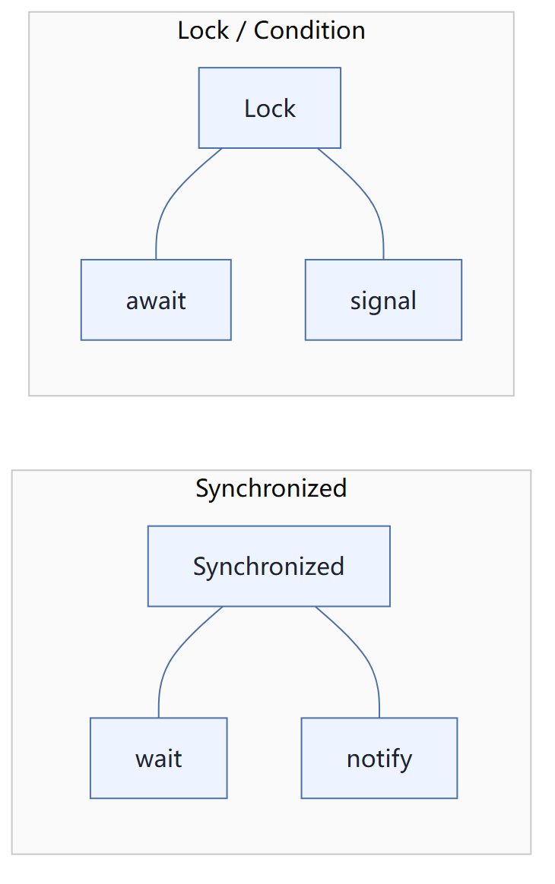
通过Lock 找到 Condition
```java
class BoundedBuffer {
    final Lock lock = new ReentrantLock();
    final Condition notFull  = lock.newCondition();
    final Condition notEmpty = lock.newCondition();

    final Object[] items = new Object[100];
    int putptr, takeptr, count;

    public void put(Object x) throws InterruptedException {
        lock.lock(); try {
            while (count == items.length)
                notFull.await();
            items[putptr] = x;
            if (++putptr == items.length) putptr = 0;
            ++count;
            notEmpty.signal();
        } finally { lock.unlock(); }
    }

    public void take() throws InterruptedException {
        lock.lock(); try {
            while (count == 0)
                notEmpty.await();
            Object x = items[takeptr];
            if (++takeptr == items.length) takeptr = 0;
            --count;
            notFull.signal();
            return x;
        } finally { lock.unlock(); }
    }
}
```

`Lock` 通过 `newCondition()` 得到 `Condition`：`notFull` 与 `notEmpty` 分别代表“未满 / 非空”两个条件，`notFull.await();`、`notEmpty.signal();` 分别对应等待与唤醒。
代码实现：
```java
package com.kuang.pc;
import java.util.concurrent.locks.Condition;
import java.util.concurrent.locks.Lock;
import java.util.concurrent.locks.ReentrantLock;
public class B  {
    public static void main(String[] args) {
        Data2 data = new Data2();
        new Thread(()->{
            for (int i = 0; i < 10; i++) {
                try {
                    data.increment();
                } catch (InterruptedException e) {
                    e.printStackTrace();
                }
            }
        },"A").start();
        new Thread(()->{
            for (int i = 0; i < 10; i++) {
                try {
                    data.decrement();
                } catch (InterruptedException e) {
                    e.printStackTrace();
                }
            }
        },"B").start();
        new Thread(()->{
            for (int i = 0; i < 10; i++) {
                try {
                    data.increment();
                } catch (InterruptedException e) {
                    e.printStackTrace();
                }
            }
        },"C").start();
        new Thread(()->{
            for (int i = 0; i < 10; i++) {
                try {
                    data.decrement();
                } catch (InterruptedException e) {
                    e.printStackTrace();
                }
            }
        },"D").start();
    }
}
// 判断等待，业务，通知
class Data2{ // 数字 资源类
    private int number = 0;
    Lock lock = new ReentrantLock();
    Condition condition = lock.newCondition();
    //condition.await(); // 等待
    //condition.signalAll(); // 唤醒全部
    //+1
    public void increment() throws InterruptedException {
        lock.lock();
        try {
            // 业务代码
            while (number!=0){  //0
                // 等待
                condition.await();
            }
            number++;
            System.out.println(Thread.currentThread().getName()+"=>"+number);
            // 通知其他线程，我+1完毕了
            condition.signalAll();
        } catch (Exception e) {
            e.printStackTrace();
        } finally {
            lock.unlock();
        }
    }
    //-1
    public synchronized void decrement() throws InterruptedException {
        lock.lock();
        try {
            while (number==0){ // 1
                // 等待
                condition.await();
            }
            number--;
            System.out.println(Thread.currentThread().getName()+"=>"+number);
            // 通知其他线程，我-1完毕了
            condition.signalAll();
        } catch (Exception e) {
            e.printStackTrace();
        } finally {
            lock.unlock();
        }
    }
}
```
**任何一个新的技术，绝对不是仅仅只是覆盖了原来的技术，优势和补充！**
### Condition 精准的通知和唤醒线程
```text
D:\Environment\Java8\jdk8\
A=>1
B=>0
C=>1
B=>0
A=>1
B=>0
A=>1
B=>0
A=>1
B=>0
A=>1
B=>0
A=>1
B=>0
A=>1
B=>0
A=>1
B=>0
A=>1
D=>0
C=>1
D=>0
```

手写
- 上面这段输出是**问题，随机的状态**——线程被唤醒的顺序不由我们控制，导致执行顺序杂乱。
- 正确的目标应当是**有序执行 A B C D**，也就是用 `Condition` 精准通知和唤醒指定的线程，而不是让线程随机争抢。
### 代码测试
```java
package com.kuang.pc;
import java.util.concurrent.locks.Condition;
import java.util.concurrent.locks.Lock;
import java.util.concurrent.locks.ReentrantLock;
/**
 * @author 狂神说Java
 * A 执行完调用B，B执行完调用C，C执行完调用A
 */
public class C {
    public static void main(String[] args) {
        Data3 data = new Data3();
        new Thread(()->{
            for (int i = 0; i <10 ; i++) {
                data.printA();
            }
        },"A").start();
        new Thread(()->{
            for (int i = 0; i <10 ; i++) {
                data.printB();
            }
        },"B").start();
        new Thread(()->{
            for (int i = 0; i <10 ; i++) {
                data.printC();
            }
        },"C").start();
    }
}
class Data3{ // 资源类 Lock
    private Lock lock = new ReentrantLock();
    private Condition condition1 = lock.newCondition();
    private Condition condition2 = lock.newCondition();
    private Condition condition3 = lock.newCondition();
    private int number = 1; // 1A  2B  3C
    public void printA(){
        lock.lock();
        try {
            // 业务，判断-> 执行-> 通知
            while (number!=1){
                // 等待
                condition1.await();
            }
            System.out.println(Thread.currentThread().getName()+"=>AAAAAAA");
            // 唤醒，唤醒指定的人，B
            number = 2;
            condition2.signal();
        } catch (Exception e) {
            e.printStackTrace();
        } finally {
            lock.unlock();
        }
    }
    public void printB(){
        lock.lock();
        try {
            // 业务，判断-> 执行-> 通知
            while (number!=2){
                condition2.await();
            }
            System.out.println(Thread.currentThread().getName()+"=>BBBBBBBBB");
            // 唤醒，唤醒指定的人，c
            number = 3;
            condition3.signal();
        } catch (Exception e) {
            e.printStackTrace();
        } finally {
            lock.unlock();
        }
    }
    public void printC(){
        lock.lock();
        try {
            // 业务，判断-> 执行-> 通知
            // 业务，判断-> 执行-> 通知
            while (number!=3){
                condition3.await();
            }
            System.out.println(Thread.currentThread().getName()+"=>BBBBBBBBB");
            // 唤醒，唤醒指定的人，c
            number = 1;
            condition1.signal();
        } catch (Exception e) {
            e.printStackTrace();
        } finally {
            lock.unlock();
        }
    }
}
```
## 5、8锁现象
如何判断锁的是谁！永远的知道什么锁，锁到底锁的是谁！
**深刻理解我们的锁**
```java
package com.kuang.lock8;
import java.util.concurrent.TimeUnit;
/**
 * 8锁，就是关于锁的8个问题
 * 1、标准情况下，两个线程先打印 发短信还是 打电话？ 1/发短信  2/打电话
 * 1、sendSms延迟4秒，两个线程先打印 发短信还是 打电话？ 1/发短信  2/打电话
 */
public class Test1 {
    public static void main(String[] args) {
        Phone phone = new Phone();
        //锁的存在
        new Thread(()->{
            phone.sendSms();
        },"A").start();
        // 捕获
        try {
            TimeUnit.SECONDS.sleep(1);
        } catch (InterruptedException e) {
            e.printStackTrace();
        }
        new Thread(()->{
            phone.call();
        },"B").start();
    }
}
class Phone{
    // synchronized 锁的对象是方法的调用者！、
    // 两个方法用的是同一个锁，谁先拿到谁执行！
    public synchronized void sendSms(){
        try {
            TimeUnit.SECONDS.sleep(4);
        } catch (InterruptedException e) {
            e.printStackTrace();
        }
        System.out.println("发短信");
    }
    public synchronized void call(){
        System.out.println("打电话");
    }
}
package com.kuang.lock8;
import java.util.concurrent.TimeUnit;
/**
 * 3、 增加了一个普通方法后！先执行发短信还是Hello？ 普通方法
 * 4、 两个对象，两个同步方法， 发短信还是 打电话？ // 打电话
 */
public class Test2  {
    public static void main(String[] args) {
        // 两个对象，两个调用者，两把锁！
        Phone2 phone1 = new Phone2();
        Phone2 phone2 = new Phone2();
        //锁的存在
        new Thread(()->{
            phone1.sendSms();
        },"A").start();
        // 捕获
        try {
            TimeUnit.SECONDS.sleep(1);
        } catch (InterruptedException e) {
            e.printStackTrace();
        }
        new Thread(()->{
            phone2.call();
        },"B").start();
    }
}
class Phone2{
    // synchronized 锁的对象是方法的调用者！
    public synchronized void sendSms(){
        try {
            TimeUnit.SECONDS.sleep(4);
        } catch (InterruptedException e) {
            e.printStackTrace();
        }
        System.out.println("发短信");
    }
    public synchronized void call(){
        System.out.println("打电话");
    }
    // 这里没有锁！不是同步方法，不受锁的影响
    public void hello(){
        System.out.println("hello");
    }
}
package com.kuang.lock8;
import java.util.concurrent.TimeUnit;
/**
 * 5、增加两个静态的同步方法，只有一个对象，先打印 发短信？打电话？
 * 6、两个对象！增加两个静态的同步方法， 先打印 发短信？打电话？
 */
public class Test3  {
    public static void main(String[] args) {
        // 两个对象的Class类模板只有一个，static，锁的是Class
        Phone3 phone1 = new Phone3();
        Phone3 phone2 = new Phone3();
        //锁的存在
        new Thread(()->{
            phone1.sendSms();
        },"A").start();
        // 捕获
        try {
            TimeUnit.SECONDS.sleep(1);
        } catch (InterruptedException e) {
            e.printStackTrace();
        }
        new Thread(()->{
            phone2.call();
        },"B").start();
    }
}
// Phone3唯一的一个 Class 对象
class Phone3{
    // synchronized 锁的对象是方法的调用者！
    // static 静态方法
    // 类一加载就有了！锁的是Class
    public static synchronized void sendSms(){
        try {
            TimeUnit.SECONDS.sleep(4);
        } catch (InterruptedException e) {
            e.printStackTrace();
        }
        System.out.println("发短信");
    }
    public static synchronized void call(){
        System.out.println("打电话");
    }
}
package com.kuang.lock8;
import java.util.concurrent.TimeUnit;
/**
 * 1、1个静态的同步方法，1个普通的同步方法 ，一个对象，先打印 发短信？打电话？
 * 2、1个静态的同步方法，1个普通的同步方法 ，两个对象，先打印 发短信？打电话？
 */
public class Test4  {
    public static void main(String[] args) {
        // 两个对象的Class类模板只有一个，static，锁的是Class
        Phone4 phone1 = new Phone4();
        Phone4 phone2 = new Phone4();
        //锁的存在
        new Thread(()->{
            phone1.sendSms();
        },"A").start();
        // 捕获
        try {
            TimeUnit.SECONDS.sleep(1);
        } catch (InterruptedException e) {
            e.printStackTrace();
        }
        new Thread(()->{
            phone2.call();
        },"B").start();
    }
}
// Phone3唯一的一个 Class 对象
class Phone4{
    // 静态的同步方法 锁的是 Class 类模板
    public static synchronized void sendSms(){
        try {
            TimeUnit.SECONDS.sleep(4);
        } catch (InterruptedException e) {
            e.printStackTrace();
        }
        System.out.println("发短信");
    }
    // 普通的同步方法  锁的调用者
    public synchronized void call(){
        System.out.println("打电话");
    }
}
```
### 小结
new  this  具体的一个手机
static  Class 唯一的一个模板
## 6、集合类不安全
### List 不安全
```java
package com.kuang.unsafe;
import java.util.*;
import java.util.concurrent.CopyOnWriteArrayList;
// java.util.ConcurrentModificationException 并发修改异常！
public class ListTest {
    public static void main(String[] args) {
        // 并发下 ArrayList 不安全的吗，Synchronized；
        /**
         * 解决方案；
         * 1、List<String> list = new Vector<>();
         * 2、List<String> list = Collections.synchronizedList(new ArrayList<>());
         * 3、List<String> list = new CopyOnWriteArrayList<>()；
         */
        // CopyOnWrite 写入时复制   COW  计算机程序设计领域的一种优化策略；
        // 多个线程调用的时候，list，读取的时候，固定的，写入（覆盖）
        // 在写入的时候避免覆盖，造成数据问题！
        // 读写分离
        // CopyOnWriteArrayList  比 Vector Nb 在哪里？
        List<String> list = new CopyOnWriteArrayList<>();
        for (int i = 1; i <= 10; i++) {
            new Thread(()->{
                list.add(UUID.randomUUID().toString().substring(0,5));
                System.out.println(list);
            },String.valueOf(i)).start();
        }
    }
}
```
小狂神推荐的上手顺序：1、先会用；2、货比三家，寻找其他解决方案；3、分析源码！
### Set 不安全
```java
package com.kuang.unsafe;
import java.util.Collections;
import java.util.HashSet;
import java.util.Set;
import java.util.UUID;
import java.util.concurrent.CopyOnWriteArraySet;
/**
 * 同理可证 ： ConcurrentModificationException
 * //1、Set<String> set = Collections.synchronizedSet(new HashSet<>());
 * //2、
 */
public class SetTest {
    public static void main(String[] args) {
//        Set<String> set = new HashSet<>();
//        Set<String> set = Collections.synchronizedSet(new HashSet<>());
        Set<String> set = new CopyOnWriteArraySet<>();
        for (int i = 1; i <=30 ; i++) {
           new Thread(()->{
               set.add(UUID.randomUUID().toString().substring(0,5));
               System.out.println(set);
           },String.valueOf(i)).start();
        }
    }
}
```
hashSet 底层是什么？
```java
public HashSet() {
    map = new HashMap<>();
}
// add set 本质就是 map key是无法重复的！
public boolean add(E e) {
    return map.put(e, PRESENT)==null;
}
private static final Object PRESENT = new Object(); // 不变得值！
```
### Map 不安全
### 回顾 Map 基本操作
```java
static final int DEFAULT_INITIAL_CAPACITY = 1 << 4; // aka 16

/**
 * The maximum capacity, used if a higher value is implicitly specified
 * by either of the constructors with arguments.
 * MUST be a power of two <= 1<<30.
 */
static final int MAXIMUM_CAPACITY = 1 << 30;

/**
 * The load factor used when none specified in constructor.
 */
static final float DEFAULT_LOAD_FACTOR = 0.75f;

/**
 * The bin count threshold for using a tree rather than list for a
 * bin.  Bins are converted to trees when adding an element to a
 * bin with at least this many nodes. The value must be greater
 * than 2 and should be at least 8 to mesh with assumptions in
 * tree removal about conversion back to plain bins upon
 * shrinkage.
 */
```

> **位运算 16**：`1 << 4` 即 2 的 4 次方，等于 16（默认初始容量）。
> **默认的加载因子**：`DEFAULT_LOAD_FACTOR = 0.75f`。
```java
package com.kuang.unsafe;
import java.util.Collections;
import java.util.HashMap;
import java.util.Map;
import java.util.UUID;
import java.util.concurrent.ConcurrentHashMap;
// ConcurrentModificationException
public class MapTest {
    public static void main(String[] args) {
        // map 是这样用的吗？ 不是，工作中不用 HashMap
        // 默认等价于什么？  new HashMap<>(16,0.75);
        // Map<String, String> map = new HashMap<>();
        // 唯一的一个家庭作业：研究ConcurrentHashMap的原理
        Map<String, String> map = new ConcurrentHashMap<>();
        for (int i = 1; i <=30; i++) {
            new Thread(()->{
                map.put(Thread.currentThread().getName(),UUID.randomUUID().toString().substring(0,5));
                System.out.println(map);
            },String.valueOf(i)).start();
        }
    }
}
```
## 7、Callable ( 简单 )
```java
@FunctionalInterface
public interface Callable<V>
```

返回结果并可能引发异常的任务。实现者定义一个没有参数的单方法，称为 `call`。

- `Callable` 该接口类似于 `Runnable`，因为它们都是为其实例可能由另一个线程执行的类设计的。
- 然而，`Runnable` **不返回结果**，也**不能抛出被检查的异常**。

`Executors` 类包含的实用方法，从其他普通形式转换为 `Callable` 类。
1、可以有返回值
2、可以抛出异常
3、方法不同，run()/  call()
代码测试
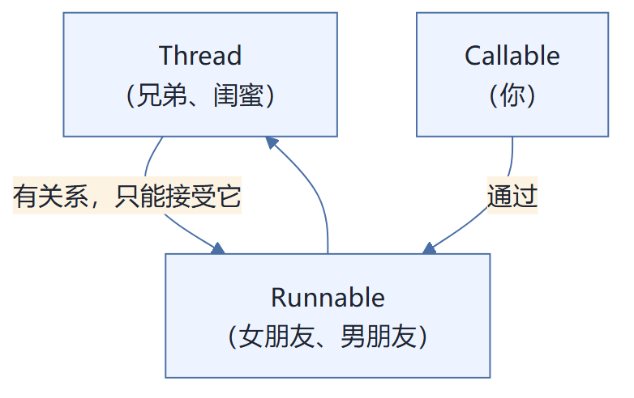

JDK 文档对 `Runnable` 的描述：

```text
compact1, compact2, compact3
java.lang

Interface Runnable

All Known Subinterfaces:
    RunnableFuture <V>, RunnableScheduledFuture <V>

所有已知实现类：
    AsyncBoxView.ChildState , ForkJoinWorkerThread , FutureTask , RenderableImageProducer , SwingWorker , Thread , TimerTask

Functional Interface:
    这是一个功能界面，因此可以用作lambda表达式或方法引用的赋值对象。
```

`Runnable` 是 `java.lang` 下的一个**函数式接口**，因此可以直接用 lambda 表达式或方法引用来创建它的实例；它的已知子接口有 `RunnableFuture<V>`、`RunnableScheduledFuture<V>`。
构造方法摘要

| 构造方法 | 描述 |
| --- | --- |
| `FutureTask(Callable<V> callable)` | 创建一个 `FutureTask`，一旦运行就执行给定的 `Callable`。 |
| `FutureTask(Runnable runnable, V result)` | 创建一个 `FutureTask`，将在运行时执行给定的 `Runnable`，并安排 `get` 将在成功完成后返回给定的结果。 |
```java
package com.kuang.callable;
import java.util.concurrent.Callable;
import java.util.concurrent.ExecutionException;
import java.util.concurrent.FutureTask;
import java.util.concurrent.locks.ReentrantLock;
/**
 * 1、探究原理
 * 2、觉自己会用
 */
public class CallableTest {
    public static void main(String[] args) throws ExecutionException, InterruptedException {
        // new Thread(new Runnable()).start();
        // new Thread(new FutureTask<V>()).start();
        // new Thread(new FutureTask<V>( Callable )).start();
        new Thread().start(); // 怎么启动Callable
        MyThread thread = new MyThread();
        FutureTask futureTask = new FutureTask(thread); // 适配类
        new Thread(futureTask,"A").start();
        new Thread(futureTask,"B").start(); // 结果会被缓存，效率高
        Integer o = (Integer) futureTask.get(); //这个get 方法可能会产生阻塞！把他放到 最后
        // 或者使用异步通信来处理！
        System.out.println(o);
    }
}
class MyThread implements Callable<Integer> {
    @Override
    public Integer call() {
        System.out.println("call()"); // 会打印几个call
        // 耗时的操作
        return 1024;
    }
}
```
**细节：**
1、有缓存
2、结果可能需要等待，会阻塞！
## 8、常用的辅助类(必会)
### 8.1、CountDownLatch
```java
public class CountDownLatch extends Object
```

允许一个或多个线程等待直到在其他线程中执行的一组操作完成的同步辅助。

`A CountDownLatch` 用给定的计数初始化。`await` 方法阻塞，直到由于 `countDown()` 方法的调用而导致当前计数达到零，之后所有等待线程被释放，并且任何后续的 `await` 调用立即返回。**这是一个一次性的现象 —— 计数无法重置。** 如果您需要重置计数的版本，请考虑使用 `CyclicBarrier`。

`A CountDownLatch` 是一种通用的同步工具，可用于多种用途。一个 `CountDownLatch` 为一个计数的 `CountDownLatch` 用作一个简单的开/关锁存器，或者门：所有线程调用 `await` 在门口等待，直到被调用 `countDown()` 的线程打开。一个 `CountDownLatch` 初始化 N 可以用来做一个线程等待，直到 N 个线程完成某项操作，或某些动作已经完成 N 次。

`CountDownLatch` 一个有用的属性是，它不要求调用 `countDown` 线程等待计数到达零之前继续，它只是阻止任何线程通过 `await`，直到所有线程可以通过。

示例用法：这是一组类，其中一组工作线程使用两个倒计时锁存器：
- 第一个是启动信号，防止任何工作人员进入，直到驾驶员准备好继续前进；
- 第二个是完成信号，允许司机等到所有的工作人员完成。

```java
class Driver { // ...
    void main() throws InterruptedException {
        CountDownLatch startSignal = new CountDownLatch(
        // ...
```

```java
package com.kuang.add;
import java.util.concurrent.CountDownLatch;
// 计数器
public class CountDownLatchDemo {
    public static void main(String[] args) throws InterruptedException {
        // 总数是6，必须要执行任务的时候，再使用！
        CountDownLatch countDownLatch = new CountDownLatch(6);
        for (int i = 1; i <=6 ; i++) {
            new Thread(()->{
                System.out.println(Thread.currentThread().getName()+" Go out");
                countDownLatch.countDown(); // 数量-1
            },String.valueOf(i)).start();
        }
        countDownLatch.await(); // 等待计数器归零，然后再向下执行
        System.out.println("Close Door");
    }
}
```
原理：
// 数量-1
```java
countDownLatch.countDown();
```
// 等待计数器归零，然后再向下执行
```java
countDownLatch.await();
```
每次有线程调用 countDown() 数量-1，假设计数器变为0，countDownLatch.await() 就会被唤醒，继续执行！
### 8.2、CyclicBarrier
`CyclicBarrier` 是**允许一组线程全部等待彼此达到共同屏障点的同步辅助**。循环阻塞在涉及固定大小的线程方的程序中很有用，这些线程必须偶尔等待彼此。屏障被称为*循环*，因为它可以在等待的线程被释放之后重新使用。

`A CyclicBarrier` 支持一个可选的 `Runnable` 命令，每个屏障点运行一次，在派对中的最后一个线程到达之后，但在任何线程释放之前。在任何一方继续进行之前，此屏障操作对更新共享状态很有用。

**示例用法：**以下是在并行分解设计中使用障碍的示例。
加法计数器
```java
package com.kuang.add;
import java.util.concurrent.BrokenBarrierException;
import java.util.concurrent.CyclicBarrier;
public class CyclicBarrierDemo {
    public static void main(String[] args) {
        /**
         * 集齐7颗龙珠召唤神龙
         */
        // 召唤龙珠的线程
        CyclicBarrier cyclicBarrier = new CyclicBarrier(7,()->{
            System.out.println("召唤神龙成功！");
        });
        for (int i = 1; i <=7 ; i++) {
            final int temp = i;
            // lambda能操作到 i 吗
            new Thread(()->{
                System.out.println(Thread.currentThread().getName()+"收 集"+temp+"个龙珠");
                try {
                    cyclicBarrier.await(); // 等待
                } catch (InterruptedException e) {
                    e.printStackTrace();
                } catch (BrokenBarrierException e) {
                    e.printStackTrace();
                }
            }).start();
        }
    }
}
```
### 8.3、Semaphore
Semaphore：信号量
`Semaphore`（信号量）官方文档说明：

**一个计数信号量。在概念上，信号量维持一组许可证。如果有必要，每个 `acquire()` 都会阻塞，直到许可证可用，然后才能使用它。每个 `release()` 添加许可证，潜在地释放阻塞获取方。但是，没有使用实际的许可证对象；`Semaphore` 只保留可用数量的计数，并相应地执行。**

信号量通常用于限制线程数，而不是访问某些（物理或逻辑）资源。例如，这是一个使用信号量来控制对一个项目池的访问的类：

```java
class Pool {
    private static final int MAX_AVAILABLE = 100;
    private final Semaphore available = new Semaphore(MAX_...
```

在获得项目之前，每个线程必须从信号量获取许可证，以确保某个项目可用。当线程完成该项目后，它将返回到池中，并将许可证返回到信号量，允许另一个线程获取该项目。请注意，当调用 `acquire()` 时，不会保持同步锁定，因为这将阻止某个项目返回到池中。信号量封装了限制对池的访问所需的同步，与保持池本身一致性所需的任何同步分开。

信号量被初始化为一个，并且被使用，使得它只有**至多一个允许可用**，可以用作**互斥锁**。这通常被称为**二进制信号量**，因为它只有两个状态：一个许可证可用，或零个许可证可用。当以这种方式使用时，二进制信号量具有属性（与许多 `Lock` 实现不同），"锁"可以由除所有者之外的线程释放（因为信号量没有所有权概念）。这在某些专门的上下文中是有用的，例如**死锁恢复**。

此类的构造函数可选择接受**公平参数**。当设置为 `false` 时，此类不会保证线程获取许可的顺序。特别是，**闯入是允许的**，也就是说，一个线程调用 `acquire()` 可以提前已经等待线程分配的许可证-在等待线程队列的头部逻辑新的线程将自己。当公平设置为 `true` 时，信号量保证调用 `acquire()` 方法的线程被选择以按照它们调用这些方法的顺序获得许可（**先进先出；FIFO**）。请注意，FIFO 排序必须适用于这些方法中的特定内部执行点。因此，一个线程可以在另一个线程之前调用 `acquire`，但是在另一个线程之后到达排序点，并且类似地从方法返回。另请注意，未定义的 `tryAcquire` 方法不符合公平性设置，但将采取任何可用的许可证。
抢车位！
6车---3个停车位置
```java
package com.kuang.add;
import java.util.concurrent.Semaphore;
import java.util.concurrent.TimeUnit;
public class SemaphoreDemo {
    public static void main(String[] args) {
        // 线程数量：停车位! 限流！
        Semaphore semaphore = new Semaphore(3);
        for (int i = 1; i <=6 ; i++) {
            new Thread(()->{
                // acquire() 得到
                try {
                    semaphore.acquire();
                    System.out.println(Thread.currentThread().getName()+"抢到车 位");
                    TimeUnit.SECONDS.sleep(2);
                    System.out.println(Thread.currentThread().getName()+"离开车 位");
                } catch (InterruptedException e) {
                    e.printStackTrace();
                } finally {
                    semaphore.release(); // release() 释放
                }
            },String.valueOf(i)).start();
        }
    }
}
```
**原理：**
获得，假设如果已经满了，等待，等待被释放为止！
```java
semaphore.acquire()
```
释放，会将当前的信号量释放 + 1，然后唤醒等待的线程！
```java
semaphore.release();
```
作用： 多个共享资源互斥的使用！并发限流，控制最大的线程数！
## 9、读写锁
### ReadWriteLock
**Interface ReadWriteLock**

所有已知实现类：`ReentrantReadWriteLock`

```java
public interface ReadWriteLock
```

A `ReadWriteLock` 维护一对关联的 `locks`，一个用于只读操作，一个用于写入。`read lock` 可以由多个阅读器线程同时进行，只要没有作者。`write lock` 是独家的。

所有 `ReadWriteLock` 实现必须保证的存储器同步效应 `writeLock` 操作（如在指定 `Lock` 接口）也保持相对于所述相关联的 `readLock`。也就是说，一个线程成功获取读锁定将会看到在之前发布的写锁定所做的所有更新。

读写锁允许访问共享数据时的并发性高于互斥锁所允许的并发性。它利用了这样一个事实：一次只有一个线程（**写入线程**）可以修改共享数据，在许多情况下，任何数量的线程都可以同时读取数据（因此**读取线程**）。从理论上讲，通过使用读写锁允许的并发性增加将导致性能改进超过使用互斥锁。实际上，并发性的增加只能在多处理器上完全实现，然后只有在共享数据的访问模式是合适的时候才可以。

读写锁是否会提高使用互斥锁的性能取决于数据被读取的频率与被修改的频率相比，读取和写入操作的持续时间以及数据的争用 - 即，将尝试同时读取或写入数据的线程数。例如，最初填充数据的集合，然后经常被修改的频繁搜索（例如某种目录）是使用读写锁的理想候选。然而，如果更新变得频繁，那么数据的大部分时间都将被专门锁定，并且并发性增加很少。此外，如果读取操作太短，则读写锁定实现（其本身比互斥锁更复杂）的开销可以支配执行成本，特别是因为许多读写锁实现仍将序列化所有线程通过小部分代码。最终，只有剖析和测量将确定使用读写锁是否适合您的应用程序。

虽然读写锁的基本操作是直接的，但是执行必须做出许多策略决策，这可能会影响给定应用程序中读写锁定的有效性。这些政策的例子包括：

- 在写入器释放写入锁定时，确定在读取器和写入器都在等待时是否授予读取锁定或写入锁定。作家偏好是常见的，因为写作预计会很短，很少见。读者喜好不常见，因为如果读者经常和长期的预期，写作可能导致漫长的延迟。公平的或按顺序的实现也是可能的。
- 确定在读取器处于活动状态并且写入器正在等待时请求读取锁定的读取器是否被授予读取锁定。读者的偏好可以无限期地推迟作者，而作对...

> **读可以被多线程同时读，写的时候只能有一个线程去写。**
```java
package com.kuang.rw;
import java.util.HashMap;
import java.util.Map;
import java.util.concurrent.locks.Lock;
import java.util.concurrent.locks.ReadWriteLock;
import java.util.concurrent.locks.ReentrantLock;
import java.util.concurrent.locks.ReentrantReadWriteLock;
/**
 * 独占锁（写锁） 一次只能被一个线程占有
 * 共享锁（读锁） 多个线程可以同时占有
 * ReadWriteLock
 * 读-读  可以共存！
 * 读-写  不能共存！
 * 写-写  不能共存！
 */
public class ReadWriteLockDemo {
    public static void main(String[] args) {
        MyCache myCache = new MyCache();
        // 写入
        for (int i = 1; i <= 5 ; i++) {
            final int temp = i;
            new Thread(()->{
                myCache.put(temp+"",temp+"");
            },String.valueOf(i)).start();
        }
        // 读取
        for (int i = 1; i <= 5 ; i++) {
            final int temp = i;
            new Thread(()->{
                myCache.get(temp+"");
            },String.valueOf(i)).start();
        }
    }
}
// 加锁的
class MyCacheLock{
    private volatile Map<String,Object> map = new HashMap<>();
    // 读写锁： 更加细粒度的控制
    private ReadWriteLock readWriteLock = new ReentrantReadWriteLock();
    private Lock lock = new ReentrantLock();
    // 存，写入的时候，只希望同时只有一个线程写
    public void put(String key,Object value){
        readWriteLock.writeLock().lock();
        try {
            System.out.println(Thread.currentThread().getName()+"写入"+key);
            map.put(key,value);
            System.out.println(Thread.currentThread().getName()+"写入OK");
        } catch (Exception e) {
            e.printStackTrace();
        } finally {
            readWriteLock.writeLock().unlock();
        }
    }
    // 取，读，所有人都可以读！
    public void get(String key){
        readWriteLock.readLock().lock();
        try {
            System.out.println(Thread.currentThread().getName()+"读取"+key);
            Object o = map.get(key);
            System.out.println(Thread.currentThread().getName()+"读取OK");
        } catch (Exception e) {
            e.printStackTrace();
        } finally {
            readWriteLock.readLock().unlock();
        }
    }
}
/**
 * 自定义缓存
 */
class MyCache{
    private volatile Map<String,Object> map = new HashMap<>();
    // 存，写
    public void put(String key,Object value){
        System.out.println(Thread.currentThread().getName()+"写入"+key);
        map.put(key,value);
        System.out.println(Thread.currentThread().getName()+"写入OK");
    }
    // 取，读
    public void get(String key){
        System.out.println(Thread.currentThread().getName()+"读取"+key);
        Object o = map.get(key);
        System.out.println(Thread.currentThread().getName()+"读取OK");
    }
}
```
## 10、阻塞队列
阻塞队列遵循 **FIFO**（先进先出），在特定条件下**不得不阻塞**：

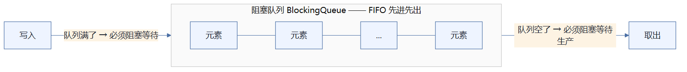

- **写入**：如果队列满了，就必须阻塞等待。
- **取**：如果队列是空的，必须阻塞等待生产。
### 阻塞队列
JDK API 帮助文档中的 **`Interface BlockingQueue<E>`**：

- 参数类型：`E` - 此集合中保存的元素的类型
- **All Superinterfaces:** `Collection <E>`，`Iterable <E>`，`Queue <E>`
- All Known Subinterfaces：`BlockingDeque <E>`，`TransferQueue <E>`
- **所有已知实现类：** `ArrayBlockingQueue`，`DelayQueue`，`LinkedBlockingDeque`，`LinkedBlockingQueue`，`LinkedTransferQueue`，`PriorityBlockingQueue`，`SynchronousQueue`

其中 `SynchronousQueue` 是**同步队列**。
```text
compact1, compact2, compact3
java.util

Interface Queue<E>

参数类型
E - 保存在此集合中的元素的类型

All Superinterfaces:
    Collection <E>, Iterable <E>

All Known Subinterfaces:
    BlockingDeque <E>, BlockingQueue <E>, Deque <E>, TransferQueue <E>

所有已知实现类：
    AbstractQueue , ArrayBlockingQueue , ArrayDeque , ConcurrentLinkedDeque , ConcurrentLinkedQueue ,
    DelayQueue , LinkedBlockingDeque , LinkedBlockingQueue , LinkedList , LinkedTransferQueue ,
    PriorityBlockingQueue , PriorityQueue , SynchronousQueue
```

手写
- `BlockingQueue<E>` —— **阻塞队列**。
- `Deque<E>` —— **双端队列**。
- `AbstractQueue`、`LinkedList`、`PriorityQueue` —— **非阻塞队列**。
BlockingQueue BlockingQueue 不是新的东西
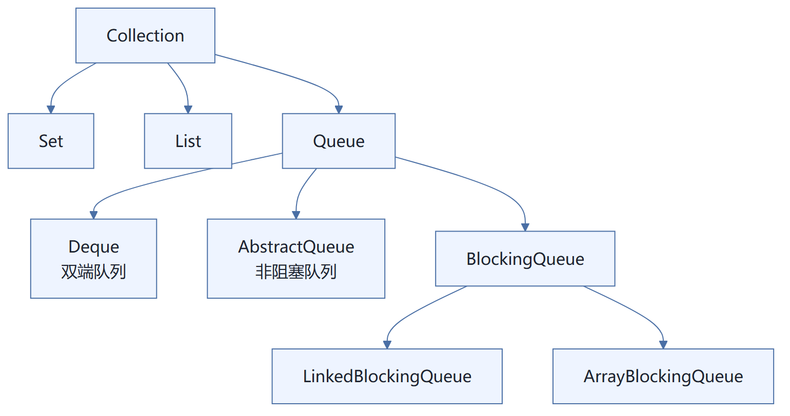
什么情况下我们会使用 阻塞队列：多线程并发处理，线程池！
**学会使用队列**：添加、移除，共四组 API。

| 方式 | 抛出异常 | 有返回值，不抛出异常 | 阻塞等待 | 超时等待 |
| --- | --- | --- | --- | --- |
| 添加 | `add` | `offer()` | `put()` | `offer(,,)` |
| 移除 | `remove` | `poll()` | `take()` | `poll(,)` |
| 检测队首元素 | `element` | `peek` | - | - |
```java
/**
 * 抛出异常
 */
public static void test1(){
    // 队列的大小
    ArrayBlockingQueue blockingQueue = new ArrayBlockingQueue<>(3);
    System.out.println(blockingQueue.add("a"));
    System.out.println(blockingQueue.add("b"));
    System.out.println(blockingQueue.add("c"));
    // IllegalStateException: Queue full 抛出异常！
    // System.out.println(blockingQueue.add("d"));
    System.out.println("=-===========");
    System.out.println(blockingQueue.remove());
    System.out.println(blockingQueue.remove());
    System.out.println(blockingQueue.remove());
    // java.util.NoSuchElementException 抛出异常！
    // System.out.println(blockingQueue.remove());
}
/**
 * 有返回值，没有异常
 */
public static void test2(){
    // 队列的大小
    ArrayBlockingQueue blockingQueue = new ArrayBlockingQueue<>(3);
    System.out.println(blockingQueue.offer("a"));
    System.out.println(blockingQueue.offer("b"));
    System.out.println(blockingQueue.offer("c"));
    // System.out.println(blockingQueue.offer("d")); // false 不抛出异常！
    System.out.println("============================");
    System.out.println(blockingQueue.poll());
    System.out.println(blockingQueue.poll());
    System.out.println(blockingQueue.poll());
    System.out.println(blockingQueue.poll()); // null  不抛出异常！
}
/**
 * 等待，阻塞（一直阻塞）
 */
public static void test3() throws InterruptedException {
    // 队列的大小
    ArrayBlockingQueue blockingQueue = new ArrayBlockingQueue<>(3);
    // 一直阻塞
    blockingQueue.put("a");
    blockingQueue.put("b");
    blockingQueue.put("c");
    // blockingQueue.put("d"); // 队列没有位置了，一直阻塞
    System.out.println(blockingQueue.take());
    System.out.println(blockingQueue.take());
    System.out.println(blockingQueue.take());
    System.out.println(blockingQueue.take()); // 没有这个元素，一直阻塞
}
/**
 * 等待，阻塞（等待超时）
 */
public static void test4() throws InterruptedException {
    // 队列的大小
    ArrayBlockingQueue blockingQueue = new ArrayBlockingQueue<>(3);
    blockingQueue.offer("a");
    blockingQueue.offer("b");
    blockingQueue.offer("c");
    // blockingQueue.offer("d",2,TimeUnit.SECONDS); // 等待超过2秒就退出
    System.out.println("===============");
    System.out.println(blockingQueue.poll());
    System.out.println(blockingQueue.poll());
    System.out.println(blockingQueue.poll());
    blockingQueue.poll(2,TimeUnit.SECONDS); // 等待超过2秒就退出
}
```
### SynchronousQueue 同步队列
没有容量，
进去一个元素，必须等待取出来之后，才能再往里面放一个元素！
put、take
```java
package com.kuang.bq;
import java.sql.Time;
import java.util.concurrent.BlockingQueue;
import java.util.concurrent.SynchronousQueue;
import java.util.concurrent.TimeUnit;
/**
 * 同步队列
 * 和其他的BlockingQueue 不一样， SynchronousQueue 不存储元素
 * put了一个元素，必须从里面先take取出来，否则不能在put进去值！
 */
public class SynchronousQueueDemo {
    public static void main(String[] args) {
        BlockingQueue<String> blockingQueue = new SynchronousQueue<>(); // 同步队 列
        new Thread(()->{
            try {
                System.out.println(Thread.currentThread().getName()+" put 1");
                blockingQueue.put("1");
                System.out.println(Thread.currentThread().getName()+" put 2");
                blockingQueue.put("2");
                System.out.println(Thread.currentThread().getName()+" put 3");
                blockingQueue.put("3");
            } catch (InterruptedException e) {
                e.printStackTrace();
            }
        },"T1").start();
        new Thread(()->{
            try {
                TimeUnit.SECONDS.sleep(3);
                System.out.println(Thread.currentThread().getName()+"=>"+blockingQueue.take());
                TimeUnit.SECONDS.sleep(3);
                System.out.println(Thread.currentThread().getName()+"=>"+blockingQueue.take());
                TimeUnit.SECONDS.sleep(3);
                System.out.println(Thread.currentThread().getName()+"=>"+blockingQueue.take());
            } catch (InterruptedException e) {
                e.printStackTrace();
            }
        },"T2").start();
    }
}
```
**学了技术，不会用！ 看的少！**
## 11、线程池(重点)
线程池：三大方法、7大参数、4种拒绝策略
### 池化技术
程序的运行，本质：占用系统的资源！ 优化资源的使用！=>池化技术
线程池、连接池、内存池、对象池///.....  创建、销毁。十分浪费资源
池化技术：事先准备好一些资源，有人要用，就来我这里拿，用完之后还给我。
**线程池的好处:**
1、降低资源的消耗
2、提高响应的速度
3、方便管理。
**线程复用、可以控制最大并发数、管理线程**
### 线程池：三大方法
4.【强制】线程池不允许使用 `Executors` 去创建，而是通过 `ThreadPoolExecutor` 的方式，这样的处理方式让写的同学更加明确线程池的运行规则，规避资源耗尽的风险。

`Executors` 返回的线程池对象的弊端如下：

1）`FixedThreadPool` 和 `SingleThreadPool`：
允许的请求队列长度为 `Integer.MAX_VALUE`，可能会堆积大量的请求，从而导致 **OOM**。
2）`CachedThreadPool` 和 `ScheduledThreadPool`：
允许的创建线程数量为 `Integer.MAX_VALUE`，可能会创建大量的线程，从而导致 **OOM**。

> `Integer.MAX_VALUE` **约为 21 亿**（2³¹ − 1 = 2147483647），如此规模的队列或线程数量必然把内存撑爆，最终导致 OOM。
```java
package com.kuang.pool;
import java.util.concurrent.ExecutorService;
import java.util.concurrent.Executors;
// Executors 工具类、3大方法
public class Demo01 {
    public static void main(String[] args) {
        ExecutorService threadPool = Executors.newSingleThreadExecutor();// 单个线 程
//        ExecutorService threadPool = Executors.newFixedThreadPool(5); // 创建一 个固定的线程池的大小
//        ExecutorService threadPool = Executors.newCachedThreadPool(); // 可伸缩 的，遇强则强，遇弱则弱
        try {
            for (int i = 0; i < 100; i++) {
                // 使用了线程池之后，使用线程池来创建线程
                threadPool.execute(()->{
                    System.out.println(Thread.currentThread().getName()+" ok");
                });
            }
        } catch (Exception e) {
            e.printStackTrace();
        } finally {
            // 线程池用完，程序结束，关闭线程池
            threadPool.shutdown();
        }
    }
}
```
### 7 大参数
### 源码分析
```java
public static ExecutorService newSingleThreadExecutor() {
    return new FinalizableDelegatedExecutorService
        (new ThreadPoolExecutor(1, 1,
                                0L, TimeUnit.MILLISECONDS,
                                new LinkedBlockingQueue<Runnable>()));
}
public static ExecutorService newFixedThreadPool(int nThreads) {
    return new ThreadPoolExecutor(5, 5,
                                  0L, TimeUnit.MILLISECONDS,
                                  new LinkedBlockingQueue<Runnable>());
}
public static ExecutorService newCachedThreadPool() {
    return new ThreadPoolExecutor(0, Integer.MAX_VALUE,
                                  60L, TimeUnit.SECONDS,
                                  new SynchronousQueue<Runnable>());
}
// 本质ThreadPoolExecutor（）
public ThreadPoolExecutor(int corePoolSize, // 核心线程池大小
                          int maximumPoolSize, // 最大核心线程池大小
                          long keepAliveTime, // 超时了没有人调用就会释放
                          TimeUnit unit, // 超时单位
                          BlockingQueue<Runnable> workQueue, // 阻塞队列
                          ThreadFactory threadFactory, // 线程工厂：创建线程的，一般 不用动
                          RejectedExecutionHandler handle // 拒绝策略) {
    if (corePoolSize < 0 ||
        maximumPoolSize <= 0 ||
        maximumPoolSize < corePoolSize ||
        keepAliveTime < 0)
        throw new IllegalArgumentException();
    if (workQueue == null || threadFactory == null || handler == null)
        throw new NullPointerException();
    this.acc = System.getSecurityManager() == null ?
        null :
    AccessController.getContext();
    this.corePoolSize = corePoolSize;
    this.maximumPoolSize = maximumPoolSize;
    this.workQueue = workQueue;
    this.keepAliveTime = unit.toNanos(keepAliveTime);
    this.threadFactory = threadFactory;
    this.handler = handler;
}
```
4、【强制】线程池不允许使用 `Executors` 去创建，而是通过 `ThreadPoolExecutor` 的方式，这样的处理方式让写的同学更加明确线程池的运行规则，规避资源耗尽的风险。

**说明：** `Executors` 返回的线程池对象的弊端如下：

1）`FixedThreadPool` 和 `SingleThreadPool`：
允许的请求队列长度为 `Integer.MAX_VALUE`，可能会堆积大量的请求，从而导致 **OOM**。

2）`CachedThreadPool` 和 `ScheduledThreadPool`：
允许的创建线程数量为 `Integer.MAX_VALUE`，可能会创建大量的线程，从而导致 **OOM**。
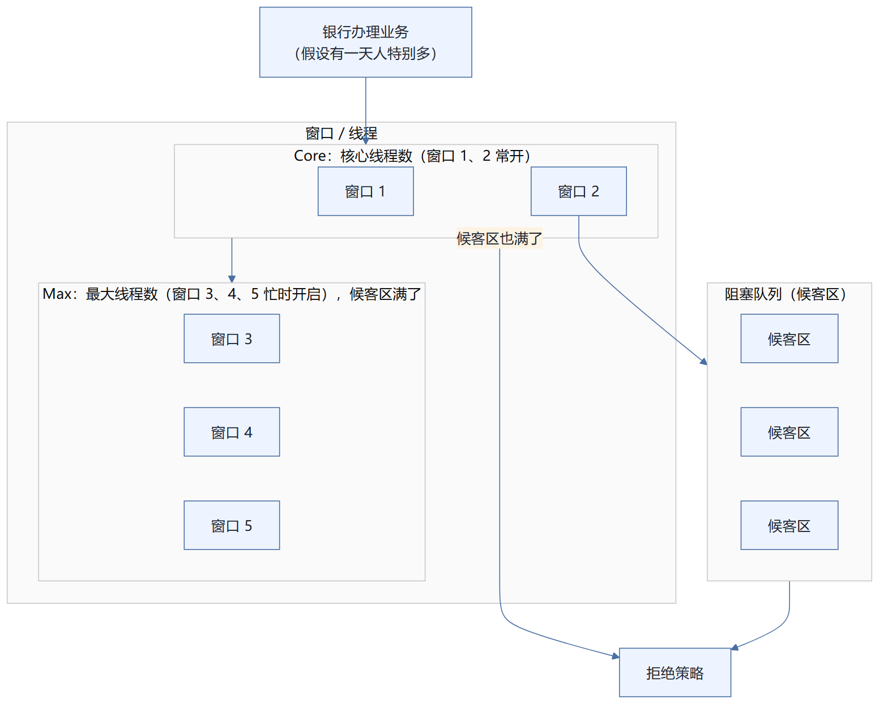

把线程池类比成**银行办理业务**：`Core` 是核心线程（窗口 1、2），`Max` 是最大线程数（候客区满了才启用窗口 3、4、5）；来人先去**阻塞队列（候客区）**排队，候客区也满了才触发**拒绝策略**。
### 手动创建一个线程池
```java
package com.kuang.pool;
import java.util.concurrent.*;
// Executors 工具类、3大方法
/**
 * new ThreadPoolExecutor.AbortPolicy() // 银行满了，还有人进来，不处理这个人的，抛出异 常
 * new ThreadPoolExecutor.CallerRunsPolicy() // 哪来的去哪里！
 * new ThreadPoolExecutor.DiscardPolicy() //队列满了，丢掉任务，不会抛出异常！
 * new ThreadPoolExecutor.DiscardOldestPolicy() //队列满了，尝试去和最早的竞争，也不会 抛出异常！
 */
public class Demo01 {
    public static void main(String[] args) {
        // 自定义线程池！工作 ThreadPoolExecutor
        ExecutorService threadPool = new ThreadPoolExecutor(
                2,
                5,
                3,
                TimeUnit.SECONDS,
                new LinkedBlockingDeque<>(3),
                Executors.defaultThreadFactory(),
                new ThreadPoolExecutor.DiscardOldestPolicy());  //队列满了，尝试去和 最早的竞争，也不会抛出异常！
        try {
            // 最大承载：Deque + max
            // 超过 RejectedExecutionException
            for (int i = 1; i <= 9; i++) {
                // 使用了线程池之后，使用线程池来创建线程
                threadPool.execute(()->{
                    System.out.println(Thread.currentThread().getName()+" ok");
                });
            }
        } catch (Exception e) {
            e.printStackTrace();
        } finally {
            // 线程池用完，程序结束，关闭线程池
            threadPool.shutdown();
        }
    }
}
```
### 4 种拒绝策略
```text
Choose Implementation of RejectedExecutionHandler (4 found)

AbortPolicy in ThreadPoolExecutor (java.util.concurrent)      < 1.8 > (rt.jar)
CallerRunsPolicy in ThreadPoolExecutor (java.util.concurrent) < 1.8 > (rt.jar)
DiscardOldestPolicy in ThreadPoolExecutor (java.util.concurrent) < 1.8 > (rt.jar)
DiscardPolicy in ThreadPoolExecutor (java.util.concurrent)    < 1.8 > (rt.jar)
```

> **四种拒绝策略**：`AbortPolicy`、`CallerRunsPolicy`、`DiscardOldestPolicy`、`DiscardPolicy`。
```java
/**
 * new ThreadPoolExecutor.AbortPolicy() // 银行满了，还有人进来，不处理这个人的，抛出异 常
 * new ThreadPoolExecutor.CallerRunsPolicy() // 哪来的去哪里！
 * new ThreadPoolExecutor.DiscardPolicy() //队列满了，丢掉任务，不会抛出异常！
 * new ThreadPoolExecutor.DiscardOldestPolicy() //队列满了，尝试去和最早的竞争，也不会 抛出异常！
 */
```
### 小结和拓展
### 池的最大大小如何设置
了解：IO密集型，CPU密集型：（调优）
```java
package com.kuang.pool;
import java.util.concurrent.*;
public class Demo01 {
    public static void main(String[] args) {
        // 自定义线程池！工作 ThreadPoolExecutor
        // 最大线程到底该如何定义
        // 1、CPU 密集型，几核，就是几，可以保持CPu的效率最高！
        // 2、IO  密集型   > 判断你程序中十分耗IO的线程，
        // 程序   15个大型任务  io十分占用资源！
        // 获取CPU的核数
        System.out.println(Runtime.getRuntime().availableProcessors());
        ExecutorService threadPool = new ThreadPoolExecutor(
                2,
                Runtime.getRuntime().availableProcessors(),
                3,
                TimeUnit.SECONDS,
                new LinkedBlockingDeque<>(3),
                Executors.defaultThreadFactory(),
                new ThreadPoolExecutor.DiscardOldestPolicy());  //队列满了，尝试去和 最早的竞争，也不会抛出异常！
        try {
            // 最大承载：Deque + max
            // 超过 RejectedExecutionException
            for (int i = 1; i <= 9; i++) {
                // 使用了线程池之后，使用线程池来创建线程
                threadPool.execute(()->{
                    System.out.println(Thread.currentThread().getName()+" ok");
                });
            }
        } catch (Exception e) {
            e.printStackTrace();
        } finally {
            // 线程池用完，程序结束，关闭线程池
            threadPool.shutdown();
        }
    }
}
```
## 12、四大函数式接口（必需掌握）
新时代的程序员：lambda表达式、链式编程、函数式接口、Stream流式计算
函数式接口： 只有一个方法的接口
```java
@FunctionalInterface
public interface Runnable {
    public abstract void run();
}
// 泛型、枚举、反射
// lambda表达式、链式编程、函数式接口、Stream流式计算
// 超级多FunctionalInterface
// 简化编程模型，在新版本的框架底层大量应用！
// foreach(消费者类的函数式接口)
```
`java.util.function` 包中的 Interfaces 列表：

```text
BiConsumer
BiFunction
BinaryOperator
BiPredicate
BooleanSupplier
Consumer
DoubleBinaryOperator
DoubleConsumer
DoubleFunction
DoublePredicate
DoubleSupplier
DoubleToIntFunction
DoubleToLongFunction
DoubleUnaryOperator
Function
IntBinaryOperator
IntConsumer
IntFunction
IntPredicate
IntSupplier
IntToDoubleFunction
IntToLongFunction
IntUnaryOperator
LongBinaryOperator
LongConsumer
LongFunction
LongPredicate
LongSupplier
LongToDoubleFunction
LongToIntFunction
LongUnaryOperator
ObjDoubleConsumer
ObjIntConsumer
ObjLongConsumer
Predicate
Supplier
ToDoubleBiFunction
ToDoubleFunction
ToIntBiFunction
ToIntFunction
ToLongBiFunction
ToLongFunction
UnaryOperator
```

四个核心函数式接口：

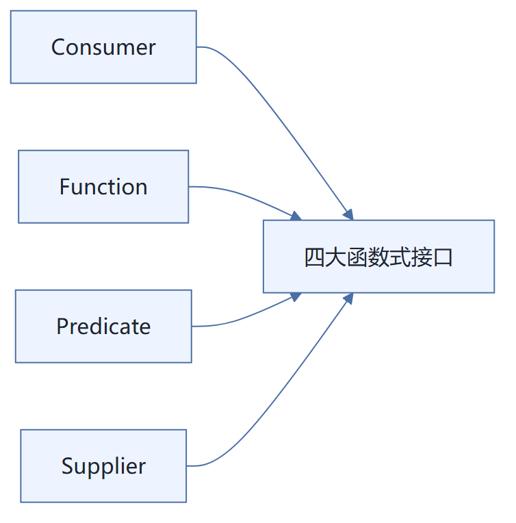
**代码测试：**
### Function 函数式接口
```java
 * @since 1.8
 */
@FunctionalInterface
public interface Function<T, R> {

    /**
     * Applies this function to the given argument.
     *
     * @param t the function argument
     * @return the function result
     */
    R apply(T t);

    /**
     ...
```

`R apply(T t);` 里，泛型 `T` 是**入参类型**，泛型 `R` 是**返回类型**。
```java
package com.kuang.function;
import java.util.function.Function;
/**
 * Function 函数型接口, 有一个输入参数，有一个输出
 * 只要是 函数型接口 可以 用 lambda表达式简化
 */
public class Demo01 {
    public static void main(String[] args) {
        //
//        Function<String,String> function = new Function<String,String>() {
//            @Override
//            public String apply(String str) {
//                return str;
//            }
//        };
        Function<String,String> function = (str)->{return str;};
        System.out.println(function.apply("asd"));
    }
}
```
### 断定型接口：有一个输入参数，返回值只能是布尔值
```java
 * @since 1.8
 */
@FunctionalInterface
public interface Predicate<T> {

    /**
     * Evaluates this predicate on the given argument.
     *
     * @param t the input argument
     * @return {@code true} if the input argument matches the predicate,
     * otherwise {@code false}
     */
    boolean test(T t);
```

手写
- `Predicate<T>` 中的 `T` 是**泛型/入参类型**，即"有一个输入参数"。
- 唯一的抽象方法是 `boolean test(T t);`，**返回值只能是布尔值**，这正是"断定型接口"的含义。
```java
package com.kuang.function;
import java.util.function.Predicate;
/**
 * 断定型接口：有一个输入参数，返回值只能是 布尔值！
 */
public class Demo02 {
    public static void main(String[] args) {
        // 判断字符串是否为空
//        Predicate<String> predicate = new Predicate<String>(){
////            @Override
////            public boolean test(String str) {
////                return str.isEmpty();
////            }
////        };
        Predicate<String> predicate = (str)->{return str.isEmpty(); };
        System.out.println(predicate.test(""));
    }
}
```
### Consumer 消费型接口
```java
/**
 * @param <T> the type of the input to the operation
 *
 * @since 1.8
 */
@FunctionalInterface
public interface Consumer<T> {

    /**
     * Performs this operation on the given argument.
     *
     * @param t the input argument
     */
    void accept(T t);

    /**
```

> **只有输入，没有返回值**：`Consumer` 是消费型接口，`accept(T t)` 方法只接收输入参数 `t`，没有返回值。
```java
package com.kuang.function;
import java.util.function.Consumer;
/**
 * Consumer 消费型接口: 只有输入，没有返回值
 */
public class Demo03 {
    public static void main(String[] args) {
//        Consumer<String> consumer = new Consumer<String>() {
//            @Override
//            public void accept(String str) {
//                System.out.println(str);
//            }
//        };
        Consumer<String> consumer = (str)->{System.out.println(str);};
        consumer.accept("sdadasd");
    }
}
```
### Supplier 供给型接口
```java
@FunctionalInterface
public interface Supplier<T> {

    /**
     * Gets a result.
     *
     * @return a result
     */
    T get();
}
```

`Supplier` **没有参数，只有返回值**（对应唯一的抽象方法 `T get()`）。
```java
package com.kuang.function;
import java.util.function.Supplier;
/**
 * Supplier 供给型接口 没有参数，只有返回值
 */
public class Demo04 {
    public static void main(String[] args) {
//        Supplier supplier = new Supplier<Integer>() {
//            @Override
//            public Integer get() {
//                System.out.println("get()");
//                return 1024;
//            }
//        };
        Supplier supplier = ()->{ return 1024; };
        System.out.println(supplier.get());
    }
}
```
## 13、Stream流式计算
### 什么是 Stream 流式计算
大数据：存储 + 计算
集合、MySQL 本质就是存储东西的；
计算都应该交给流来操作！
JDK API 帮助文档中的 `Stream` 接口：

```text
java.util.stream
Interface Stream<T>

参数类型
T - 流元素的类型
All Superinterfaces:
AutoCloseable , BaseStream <T, Stream <T>>
```

```java
package com.kuang.stream;
import java.util.Arrays;
import java.util.List;
/**
 * 题目要求：一分钟内完成此题，只能用一行代码实现！
 * 现在有5个用户！筛选：
 * 1、ID 必须是偶数
 * 2、年龄必须大于23岁
 * 3、用户名转为大写字母
 * 4、用户名字母倒着排序
 * 5、只输出一个用户！
 */
public class Test {
    public static void main(String[] args) {
        User u1 = new User(1,"a",21);
        User u2 = new User(2,"b",22);
        User u3 = new User(3,"c",23);
        User u4 = new User(4,"d",24);
        User u5 = new User(6,"e",25);
        // 集合就是存储
        List<User> list = Arrays.asList(u1, u2, u3, u4, u5);
        // 计算交给Stream流
        // lambda表达式、链式编程、函数式接口、Stream流式计算
        list.stream()
                .filter(u->{return u.getId()%2==0;})
                .filter(u->{return u.getAge()>23;})
                .map(u->{return u.getName().toUpperCase();})
                .sorted((uu1,uu2)->{return uu2.compareTo(uu1);})
                .limit(1)
                .forEach(System.out::println);
    }
}
```
## 14、ForkJoin
### 什么是 ForkJoin
ForkJoin 在 JDK 1.7 ， 并行执行任务！提高效率。大数据量！
大数据：Map Reduce （把大任务拆分为小任务）
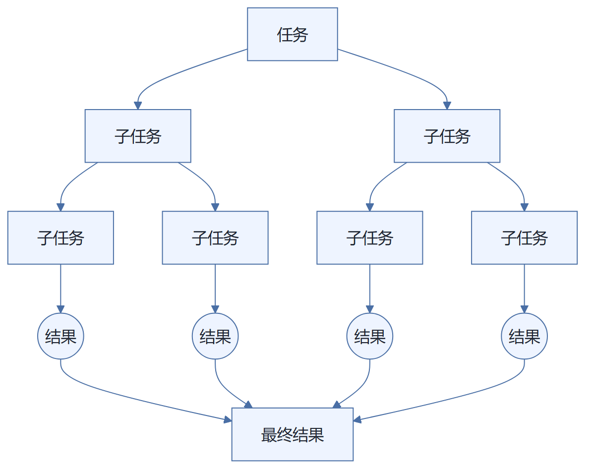

ForkJoin：把一个大**任务**不断 `fork` 拆分成多个**子任务**并行执行，各子任务得到**结果**后再 `join` 合并，最终汇聚成**最终结果**（对应"大任务拆分为小任务"的 Map Reduce 思想）。
### ForkJoin 特点：工作窃取
这个里面维护的都是双端队列
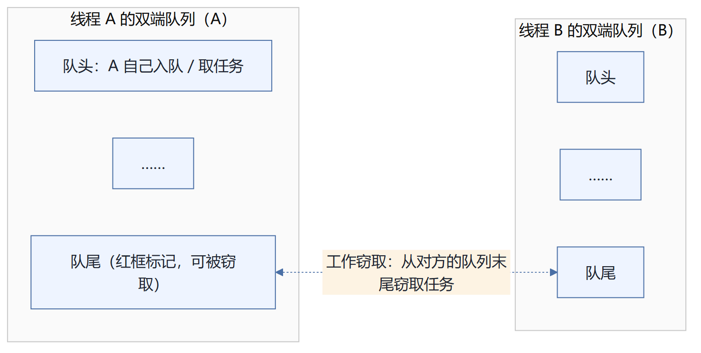
### ForkJoin
```text
... 指定集合内，而不改变其执行状态。

void    execute(ForkJoinTask<?> task)
        为异步执行给定任务的排列。
```

`execute(ForkJoinTask<?> task)`：通过该方法把 `ForkJoinTask` 提交给 `ForkJoinPool` 异步执行。
JDK API 帮助文档中的 `ForkJoinTask` 类：

```text
compact1, compact2, compact3
java.util.concurrent
Class ForkJoinTask<V>

java.lang.Object
    java.util.concurrent.ForkJoinTask<V>

All Implemented Interfaces:
Serializable , Future <V>

已知直接子类：
CountedCompleter , RecursiveAction , RecursiveTask
```

`RecursiveAction` 是**递归任务，没有返回值**；`RecursiveTask` 是**递归任务，有返回值**。
```java
package com.kuang.forkjoin;
import java.util.concurrent.RecursiveTask;
/**
 * 求和计算的任务！
 * 3000   6000（ForkJoin）  9000（Stream并行流）
 * // 如何使用 forkjoin
 * // 1、forkjoinPool 通过它来执行
 * // 2、计算任务 forkjoinPool.execute(ForkJoinTask task)
 * // 3. 计算类要继承 ForkJoinTask
 */
public class ForkJoinDemo extends RecursiveTask<Long> {
    private Long start;  // 1
    private Long end;    // 1990900000
    // 临界值
    private Long temp = 10000L;
    public ForkJoinDemo(Long start, Long end) {
        this.start = start;
        this.end = end;
    }
    // 计算方法
    @Override
    protected Long compute() {
        if ((end-start)<temp){
            Long sum = 0L;
            for (Long i = start; i <= end; i++) {
                sum += i;
            }
            return sum;
        }else { // forkjoin 递归
            long middle = (start + end) / 2; // 中间值
            ForkJoinDemo task1 = new ForkJoinDemo(start, middle);
            task1.fork(); // 拆分任务，把任务压入线程队列
            ForkJoinDemo task2 = new ForkJoinDemo(middle+1, end);
            task2.fork(); // 拆分任务，把任务压入线程队列
            return task1.join() + task2.join();
        }
    }
}
```
### 测试
```java
package com.kuang.forkjoin;
import java.util.concurrent.ExecutionException;
import java.util.concurrent.ForkJoinPool;
import java.util.concurrent.ForkJoinTask;
import java.util.stream.DoubleStream;
import java.util.stream.IntStream;
import java.util.stream.LongStream;
/**
 * 同一个任务，别人效率高你几十倍！
 */
public class Test {
    public static void main(String[] args) throws ExecutionException, InterruptedException {
        // test1(); // 12224
        // test2(); // 10038
        // test3(); // 153
    }
    // 普通程序员
    public static void test1(){
        Long sum = 0L;
        long start = System.currentTimeMillis();
        for (Long i = 1L; i <= 10_0000_0000; i++) {
            sum += i;
        }
        long end = System.currentTimeMillis();
        System.out.println("sum="+sum+" 时间："+(end-start));
    }
    // 会使用ForkJoin
    public static void test2() throws ExecutionException, InterruptedException {
        long start = System.currentTimeMillis();
        ForkJoinPool forkJoinPool = new ForkJoinPool();
        ForkJoinTask<Long> task = new ForkJoinDemo(0L, 10_0000_0000L);
        ForkJoinTask<Long> submit = forkJoinPool.submit(task);// 提交任务
        Long sum = submit.get();
        long end = System.currentTimeMillis();
        System.out.println("sum="+sum+" 时间："+(end-start));
    }
    public static void test3(){
        long start = System.currentTimeMillis();
        // Stream并行流 ()  (]
        long sum = LongStream.rangeClosed(0L, 10_0000_0000L).parallel().reduce(0, Long::sum);
        long end = System.currentTimeMillis();
        System.out.println("sum="+"时间："+(end-start));
    }
}
```
## 15、异步回调
Future 设计的初衷： 对将来的某个事件的结果进行建模
```text
java.util.concurrent

Class CompletableFuture<T>

java.lang.Object
    java.util.concurrent.CompletableFuture<T>

All Implemented Interfaces:
CompletionStage <T>, Future <T>
```

`CompletableFuture<T>` 继承自 `java.lang.Object`，实现了 `CompletionStage<T>` 与 `Future<T>` 两个接口，是异步回调编程的核心类。
```java
package com.kuang.future;
import java.util.concurrent.CompletableFuture;
import java.util.concurrent.ExecutionException;
import java.util.concurrent.Future;
import java.util.concurrent.TimeUnit;
/**
 * 异步调用： CompletableFuture
 * // 异步执行
 * // 成功回调
 * // 失败回调
 */
public class Demo01 {
    public static void main(String[] args) throws ExecutionException, InterruptedException {
        // 没有返回值的 runAsync 异步回调
//        CompletableFuture<Void> completableFuture = CompletableFuture.runAsync(()->{
//            try {
//                TimeUnit.SECONDS.sleep(2);
//            } catch (InterruptedException e) {
//                e.printStackTrace();
//            }
//
System.out.println(Thread.currentThread().getName()+"runAsync=>Void");
//        });
//
//        System.out.println("1111");
//
//        completableFuture.get(); // 获取阻塞执行结果
        // 有返回值的 supplyAsync 异步回调
        // ajax，成功和失败的回调
        // 返回的是错误信息；
        CompletableFuture<Integer> completableFuture = CompletableFuture.supplyAsync(()->{
System.out.println(Thread.currentThread().getName()+"supplyAsync=>Integer");
            int i = 10/0;
            return 1024;
        });
        System.out.println(completableFuture.whenComplete((t, u) -> {
            System.out.println("t=>" + t); // 正常的返回结果
            System.out.println("u=>" + u); // 错误信息：
java.util.concurrent.CompletionException: java.lang.ArithmeticException: / by zero
        }).exceptionally((e) -> {
            System.out.println(e.getMessage());
            return 233; // 可以获取到错误的返回结果
        }).get());
        /**
         * succee Code 200
         * error Code 404 500
         */
    }
}
```
## 16、JMM
请你谈谈你对 Volatile 的理解
Volatile 是 Java 虚拟机提供轻量级的同步机制
1、保证可见性
2、不保证原子性
3、禁止指令重排
### 什么是 JMM
JMM ： Java内存模型，不存在的东西，概念！约定！
**关于JMM的一些同步的约定：**
1、线程解锁前，必须把共享变量立刻刷回主存。
2、线程加锁前，必须读取主存中的最新值到工作内存中！
3、加锁和解锁是同一把锁
线程  工作内存  、主内存
**8种操作：**
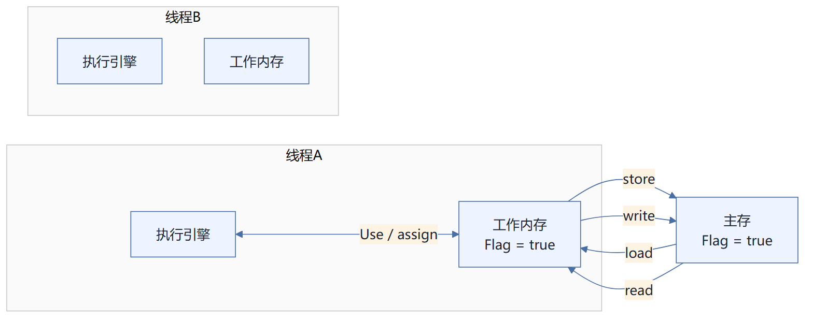

> 图中标注的 `lock`、`unlock` 以及 `load`、`read`、`write`、`store` 均属于 JMM 的 8 种内存交互操作。
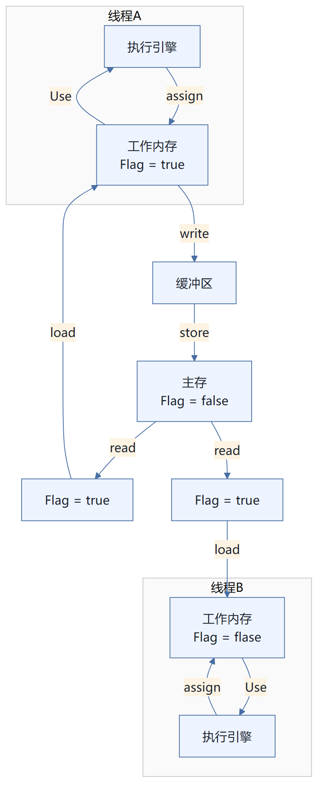

**问题：线程B修改了值，但是线程A不能及时可见。**
**内存交互操作有8种，虚拟机实现必须保证每一个操作都是原子的，不可在分的（对于double和long类****型的变量来说，load、store、read和write操作在某些平台上允许例外）**
lock   （锁定）：作用于主内存的变量，把一个变量标识为线程独占状态
unlock （解锁）：作用于主内存的变量，它把一个处于锁定状态的变量释放出来，释放后的变量才可以被其他线程锁定
read  （读取）：作用于主内存变量，它把一个变量的值从主内存传输到线程的工作内存中，以便随后的load动作使用
load   （载入）：作用于工作内存的变量，它把read操作从主存中变量放入工作内存中
use   （使用）：作用于工作内存中的变量，它把工作内存中的变量传输给执行引擎，每当虚拟机遇到一个需要使用到变量的值，就会使用到这个指令
assign （赋值）：作用于工作内存中的变量，它把一个从执行引擎中接受到的值放入工作内存的变量副本中
store  （存储）：作用于主内存中的变量，它把一个从工作内存中一个变量的值传送到主内存中，以便后续的write使用
write  （写入）：作用于主内存中的变量，它把store操作从工作内存中得到的变量的值放入主内存的变量中
**JMM对这八种指令的使用，制定了如下规则：**
不允许read和load、store和write操作之一单独出现。即使用了read必须load，使用了store必须write
不允许线程丢弃他最近的assign操作，即工作变量的数据改变了之后，必须告知主存
不允许一个线程将没有assign的数据从工作内存同步回主内存
一个新的变量必须在主内存中诞生，不允许工作内存直接使用一个未被初始化的变量。就是怼变量实施use、store操作之前，必须经过assign和load操作
一个变量同一时间只有一个线程能对其进行lock。多次lock后，必须执行相同次数的unlock才能解锁
如果对一个变量进行lock操作，会清空所有工作内存中此变量的值，在执行引擎使用这个变量前，必须重新load或assign操作初始化变量的值
如果一个变量没有被lock，就不能对其进行unlock操作。也不能unlock一个被其他线程锁住的变量
对一个变量进行unlock操作之前，必须把此变量同步回主内存
问题： 程序不知道主内存的值已经被修改过了
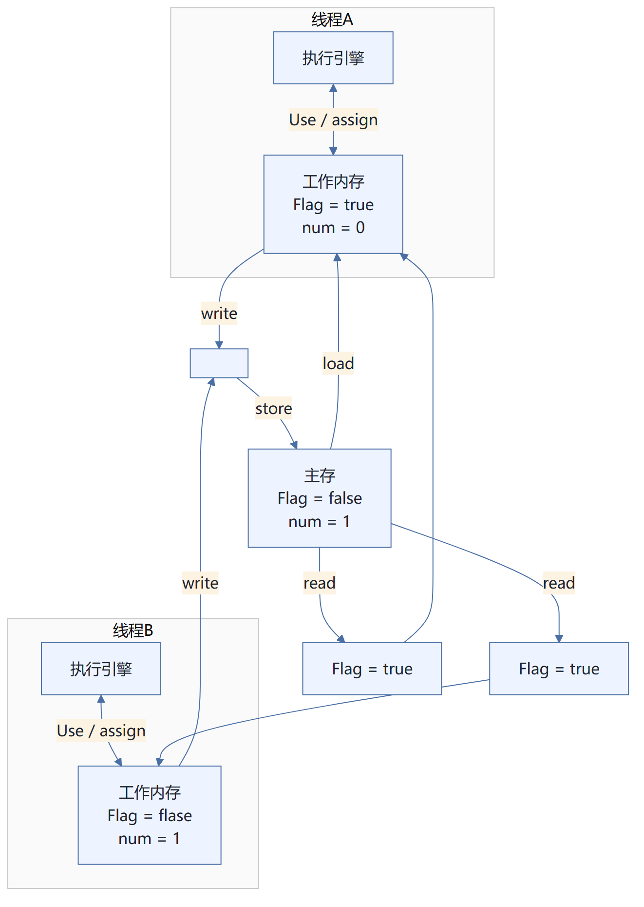

> 需要线程 A 知道主内存里的值发生了变化。
## 17、Volatile
### 1、保证可见性
```java
package com.kuang.tvolatile;
import java.util.concurrent.TimeUnit;
public class JMMDemo {
    // 不加 volatile 程序就会死循环！
    // 加 volatile 可以保证可见性
    private volatile static int num = 0;
    public static void main(String[] args) { // main
        new Thread(()->{ // 线程 1 对主内存的变化不知道的
            while (num==0){
            }
        }).start();
        try {
            TimeUnit.SECONDS.sleep(1);
        } catch (InterruptedException e) {
            e.printStackTrace();
        }
        num = 1;
        System.out.println(num);
    }
}
```
### 2、不保证原子性
原子性 : 不可分割
线程A在执行任务的时候，不能被打扰的，也不能被分割。要么同时成功，要么同时失败。
```java
package com.kuang.tvolatile;
// volatile 不保证原子性
public class VDemo02 {
    // volatile 不保证原子性
    private volatile static int num = 0;
    public static void add(){
        num++;
    }
    public static void main(String[] args) {
        //理论上num结果应该为 2 万
        for (int i = 1; i <= 20; i++) {
            new Thread(()->{
                for (int j = 0; j < 1000 ; j++) {
                    add();
                }
            }).start();
        }
        while (Thread.activeCount()>2){ // main  gc
            Thread.yield();
        }
        System.out.println(Thread.currentThread().getName() + " " + num);
    }
}
```
**如果不加 lock 和 synchronized ，怎么样保证原子性**
`num++` 在源码里只有一行：

```java
// volatile 不保证原子性
public class VDemo02 {

    // volatile 不保证原子性
    private volatile static int num

    public static void add(){
        num++;   // 不是获得这个值 操作
    }            // 2、+1

                 // 3、写回这个值

    public static void main(String[
        //理论上num结果应该为 2 万
```

它的 `javap -c` 反编译结果：

```text
C:\Users\Administrator\Desktop\并发编程\juc\target\classes\com...
Compiled from "VDemo02.java"
public class com.kuang.tvolatile.VDemo02 {
  public com.kuang.tvolatile.VDemo02();
    Code:
       0: aload_0
       1: invokespecial #1                  // Method java/lang/...
       4: return

  public static void add();
    Code:
       0: getstatic     #2                  // Field num:I
       3: iconst_1
       4: iadd
       5: putstatic     #2                  // Field num:I
       8: return

  public static void main(java.lang.String[]);
    Code:
       0: iconst_1
       1: istore_1
       2: iload_1
       3: ...
```

手写
- 红色箭头由源码里的 `num++` 指向字节码中的 `add()` 方法，说明 `num++` 这样一行代码，在字节码层面并**不是原子的**，而是被拆成了三步：
  1. `getstatic` —— **不是获得这个值**（取值）
  2. `iconst_1` + `iadd` —— **+1**（加一）
  3. `putstatic` —— **写回这个值**（写回主内存）
- 因为 `volatile` 只保证可见性和有序性、**不保证原子性**，多线程下 `num++` 交错执行就会出现丢失更新，所以 `num` 最终结果达不到预期的 2 万。
### 使用原子类解决原子性问题
```text
java.time.temporal
java.time.zone
java.util
java.util.concurrent
java.util.concurrent.atomic        ← 原子
java.util.concurrent.locks
java.util.function
java.util.jar
java.util.logging
java.util.prefs
java.util.regex
java.util.spi
java.util.stream
java.util.zip
javax.accessibility

java.util.concurrent.atomic

Classes
AtomicBoolean
AtomicInteger
AtomicIntegerArray
AtomicIntegerFieldUpdater
AtomicLong
AtomicLongArray
AtomicLongFieldUpdater
AtomicMarkableReference
AtomicReference
AtomicReferenceArray
AtomicReferenceFieldUpdater
AtomicStampedReference
DoubleAccumulator
DoubleAdder
LongAccumulator
LongAdder
```

> **原子**：`java.util.concurrent.atomic` 包下提供原子类，常用的有 `AtomicBoolean`、`AtomicInteger`、`AtomicLong` 等。
```java
package com.kuang.tvolatile;
import java.util.concurrent.atomic.AtomicInteger;
// volatile 不保证原子性
public class VDemo02 {
    // volatile 不保证原子性
    // 原子类的 Integer
    private volatile static AtomicInteger num = new AtomicInteger();
    public static void add(){
        // num++; // 不是一个原子性操作
        num.getAndIncrement(); // AtomicInteger + 1 方法， CAS
    }
    public static void main(String[] args) {
        //理论上num结果应该为 2 万
        for (int i = 1; i <= 20; i++) {
            new Thread(()->{
                for (int j = 0; j < 1000 ; j++) {
                    add();
                }
            }).start();
        }
        while (Thread.activeCount()>2){ // main  gc
            Thread.yield();
        }
        System.out.println(Thread.currentThread().getName() + " " + num);
    }
}
```
这些类的底层都直接和操作系统挂钩！在内存中修改值！Unsafe类是一个很特殊的存在！
### 指令重排
**什么是 指令重排：你写的程序，计算机并不是按照你写的那样去执行的。**
源代码-->编译器优化的重排--> 指令并行也可能会重排--> 内存系统也会重排--->  执行
**处理器在进行指令重排的时候，考虑：数据之间的依赖性！**
```java
int x = 1; // 1
int y = 2; // 2
x = x + 5; // 3
y = x * x; // 4
我们所期望的：1234  但是可能执行的时候回变成 2134  1324
可不可能是  4123！
```
可能造成影响的结果： a b x y 这四个值默认都是 0；
| 线程A | 线程B |
| --- | --- |
| x=a | y=b |
| b=1 | a=2 |
正常的结果： x = 0；y = 0；但是可能由于指令重排
| 线程A | 线程B |
| --- | --- |
| b=1 | a=2 |
| x=a | y=b |
指令重排导致的诡异结果： x = 2；y = 1；
非计算机专业
**volatile可以避免指令重排：**
内存屏障。CPU指令。作用：
1、保证特定的操作的执行顺序！
2、可以保证某些变量的内存可见性 （利用这些特性volatile实现了可见性）
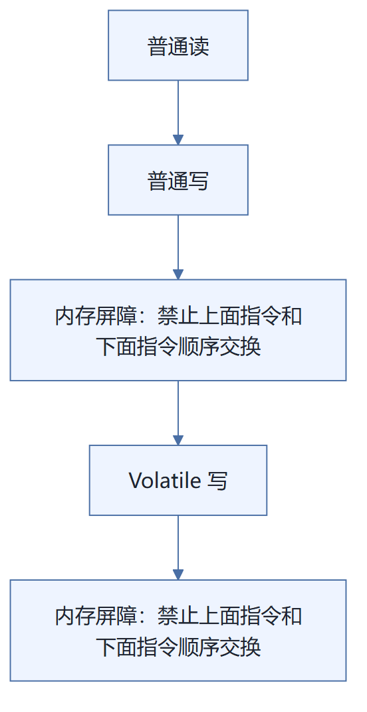

`Volatile 写` 前后各有一道**内存屏障**，作用是**禁止上面指令和下面指令交换顺序**，也就是禁止指令重排。
**Volatile 是可以保持 可见性。不能保证原子性，由于内存屏障，可以保证避免指令重排的现象产生！**
## 18、彻底玩转单例模式
饿汉式   DCL懒汉式，深究！
### 饿汉式
```java
package com.kuang.single;
// 饿汉式单例
public class Hungry {
    // 可能会浪费空间
    private byte[] data1 = new byte[1024*1024];
    private byte[] data2 = new byte[1024*1024];
    private byte[] data3 = new byte[1024*1024];
    private byte[] data4 = new byte[1024*1024];
    private Hungry(){
    }
    private final static Hungry HUNGRY = new Hungry();
    public static Hungry getInstance(){
        return HUNGRY;
    }
}
```
### DCL 懒汉式
```java
package com.kuang.single;
import com.sun.corba.se.impl.orbutil.CorbaResourceUtil;
import java.lang.reflect.Constructor;
import java.lang.reflect.Field;
// 懒汉式单例
// 道高一尺，魔高一丈！
public class LazyMan {
    private static boolean qinjiang = false;
    private LazyMan(){
        synchronized (LazyMan.class){
            if (qinjiang == false){
                qinjiang = true;
            }else {
                throw new RuntimeException("不要试图使用反射破坏异常");
            }
        }
    }
    private volatile static LazyMan lazyMan;
    // 双重检测锁模式的 懒汉式单例  DCL懒汉式
    public static LazyMan getInstance(){
        if (lazyMan==null){
            synchronized (LazyMan.class){
                if (lazyMan==null){
                    lazyMan = new LazyMan(); // 不是一个原子性操作
                }
            }
        }
        return lazyMan;
    }
    // 反射！
    public static void main(String[] args) throws Exception {
//        LazyMan instance = LazyMan.getInstance();
        Field qinjiang = LazyMan.class.getDeclaredField("qinjiang");
        qinjiang.setAccessible(true);
        Constructor<LazyMan> declaredConstructor = LazyMan.class.getDeclaredConstructor(null);
        declaredConstructor.setAccessible(true);
        LazyMan instance = declaredConstructor.newInstance();
        qinjiang.set(instance,false);
        LazyMan instance2 = declaredConstructor.newInstance();
        System.out.println(instance);
        System.out.println(instance2);
    }
}
/**
 * 1. 分配内存空间
 * 2、执行构造方法，初始化对象
 * 3、把这个对象指向这个空间
 *
 * 123
 * 132 A
 *     B // 此时lazyMan还没有完成构造
 */
```
### 静态内部类
```java
package com.kuang.single;
// 静态内部类
public class Holder {
    private Holder(){
    }
    public static Holder getInstace(){
        return InnerClass.HOLDER;
    }
    public static class InnerClass{
        private static final Holder HOLDER = new Holder();
    }
}
```
### 单例不安全，反射
### 枚举
```java
package com.kuang.single;
import java.lang.reflect.Constructor;
import java.lang.reflect.InvocationTargetException;
// enum 是一个什么？ 本身也是一个Class类
public enum EnumSingle {
    INSTANCE;
    public EnumSingle getInstance(){
        return INSTANCE;
    }
}
class Test{
    public static void main(String[] args) throws NoSuchMethodException, IllegalAccessException, InvocationTargetException, InstantiationException {
        EnumSingle instance1 = EnumSingle.INSTANCE;
        Constructor<EnumSingle> declaredConstructor = EnumSingle.class.getDeclaredConstructor(String.class,int.class);
        declaredConstructor.setAccessible(true);
        EnumSingle instance2 = declaredConstructor.newInstance();
        // NoSuchMethodException: com.kuang.single.EnumSingle.<init>()
        System.out.println(instance1);
        System.out.println(instance2);
    }
}
C:\Users\Administrator\Desktop\并发编程\juc\target\classes\com\kuang\single>javap -p EnumSingle.class
Compiled from "EnumSingle.java"
public final class com.kuang.single.EnumSingle extends java.lang.Enum<com.kuang.single.EnumSingle> {
  public static final com.kuang.single.EnumSingle INSTANCE;
  private static final com.kuang.single.EnumSingle[] $VALUES;
  public static com.kuang.single.EnumSingle[] values();
  public static com.kuang.single.EnumSingle valueOf(java.lang.String);
  private com.kuang.single.EnumSingle();
  public com.kuang.single.EnumSingle getInstance();
  static {};
}
```

类声明 `public final class com.kuang.single.EnumSingle extends java.lang.Enum<com.kuang.single.EnumSingle>`，加上私有构造 `private com.kuang.single.EnumSingle();`，这就是枚举单例的本质。
枚举类型的最终反编译源码：
```java
// Decompiled by Jad v1.5.8g. Copyright 2001 Pavel Kouznetsov.
// Jad home page: http://www.kpdus.com/jad.html
// Decompiler options: packimports(3)
// Source File Name:   EnumSingle.java
package com.kuang.single;
public final class EnumSingle extends Enum
{
    public static EnumSingle[] values()
    {
        return (EnumSingle[])$VALUES.clone();
    }
    public static EnumSingle valueOf(String name)
    {
        return (EnumSingle)Enum.valueOf(com/kuang/single/EnumSingle, name);
    }
    private EnumSingle(String s, int i)
    {
        super(s, i);
    }
    public EnumSingle getInstance()
    {
        return INSTANCE;
    }
    public static final EnumSingle INSTANCE;
    private static final EnumSingle $VALUES[];
    static
    {
        INSTANCE = new EnumSingle("INSTANCE", 0);
        $VALUES = (new EnumSingle[] {
            INSTANCE
        });
    }
}
```
## 19、深入理解CAS
### 什么是 CAS
大厂你必须要深入研究底层！有所突破！ 修内功，操作系统，计算机网络原理
```java
package com.kuang.cas;
import java.util.concurrent.atomic.AtomicInteger;
public class CASDemo {
    // CAS  compareAndSet : 比较并交换！
    public static void main(String[] args) {
        AtomicInteger atomicInteger = new AtomicInteger(2020);
        // 期望、更新
        // public final boolean compareAndSet(int expect, int update)
        // 如果我期望的值达到了，那么就更新，否则，就不更新, CAS 是CPU的并发原语！
        System.out.println(atomicInteger.compareAndSet(2020, 2021));
        System.out.println(atomicInteger.get());
        atomicInteger.getAndIncrement();
        System.out.println(atomicInteger.compareAndSet(2020, 2021));
        System.out.println(atomicInteger.get());
    }
}
```
### Unsafe 类
```java
public class AtomicInteger extends Number implements java.io.Serializable {
    private static final long serialVersionUID = 6214790243416807050L;

    // setup to use Unsafe.compareAndSwapInt for updates
    private static final Unsafe unsafe = Unsafe.getUnsafe();
    private static final long valueOffset;

    static {
        try {
            valueOffset = unsafe.objectFieldOffset
                (AtomicInteger.class.getDeclaredField("value"));
        } catch (Exception ex) { throw new Error(ex); }
    }

    private volatile int value;

    /**
```

手写
- `private static final Unsafe unsafe = Unsafe.getUnsafe();` —— `AtomicInteger` 底层就是靠 `Unsafe` 类来完成的。
- `valueOffset = unsafe.objectFieldOffset(...)` —— 通过 `Unsafe` 取得字段在内存中的偏移量。
- `private volatile int value;` —— `value` 用 `volatile` 修饰，保证多线程下的**可见性**。
- `Unsafe` 是 Java 留的后门：Java 本身不能操作内存，但可以调用 C++ 的 native 方法，而 C++ 能操作内存，于是经由 `Unsafe` 就能间接读到、改到指定内存。
```java
public native void putDoubleVolatile(Object var1, long var2, double var4);

public final int getAndIncrement() {
    return unsafe.getAndAddInt(this, valueOffset, 1);
}

public native void putOrderedLong(Object var1, long var2, long var4);

public native void unpark(Object var1);

public native void park(boolean var1, long var2);

public native int getLoadAverage(double var1, int var2);

public final int getAndAddInt(Object var1, long var2, int var4) {
    int var5;
    do {
        var5 = this.getIntVolatile(var1, var2);
    } while(!this.compareAndSwapInt(var1, var2, var5, var5 + var4));

    return var5;
}
```

> - `getIntVolatile(var1, var2)`：**获取内存地址中的值**。
> - `compareAndSwapInt(var1, var2, var5, var5 + var4)`：比较并交换，**内存操作，效率很高**。这就是 CAS 的底层实现（`Unsafe` 类，直接操作内存）。
```java
public final int getAndAddInt(Object var1, long var2, int var4) {
    int var5;
    do {
        var5 = this.getIntVolatile(var1, var2);
    } while(!this.compareAndSwapInt(var1, var2, var5, var5 + var4));

    return var5;
}
```

`while(!this.compareAndSwapInt(...))` 这一段就是**自旋锁** —— CAS 失败就一直循环重试，直到成功为止。
CAS ： 比较当前工作内存中的值和主内存中的值，如果这个值是期望的，那么则执行操作！如果不是就一直循环！
**缺点：**
1、 循环会耗时
2、一次性只能保证一个共享变量的原子性
3、ABA问题
### CAS 的 ABA 问题（狸猫换太子）
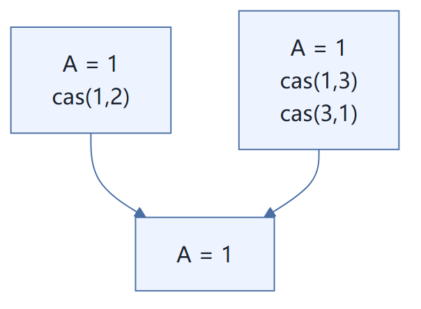

```java
package com.kuang.cas;
import java.util.concurrent.atomic.AtomicInteger;
public class CASDemo {
    // CAS  compareAndSet : 比较并交换！
    public static void main(String[] args) {
        AtomicInteger atomicInteger = new AtomicInteger(2020);
        // 期望、更新
        // public final boolean compareAndSet(int expect, int update)
        // 如果我期望的值达到了，那么就更新，否则，就不更新, CAS 是CPU的并发原语！
        // ============== 捣乱的线程 ==================
        System.out.println(atomicInteger.compareAndSet(2020, 2021));
        System.out.println(atomicInteger.get());
        System.out.println(atomicInteger.compareAndSet(2021, 2020));
        System.out.println(atomicInteger.get());
        // ============== 期望的线程 ==================
        System.out.println(atomicInteger.compareAndSet(2020, 6666));
        System.out.println(atomicInteger.get());
    }
}
```
## 20、原子引用
解决ABA 问题，引入原子引用！ 对应的思想：乐观锁！
带版本号 的原子操作！
```java
package com.kuang.cas;
import java.util.concurrent.TimeUnit;
import java.util.concurrent.atomic.AtomicStampedReference;
public class CASDemo {
    //AtomicStampedReference 注意，如果泛型是一个包装类，注意对象的引用问题
    // 正常在业务操作，这里面比较的都是一个个对象
    static AtomicStampedReference<Integer> atomicStampedReference = new AtomicStampedReference<>(1,1);
    // CAS  compareAndSet : 比较并交换！
    public static void main(String[] args) {
        new Thread(()->{
            int stamp = atomicStampedReference.getStamp(); // 获得版本号
            System.out.println("a1=>"+stamp);
            try {
                TimeUnit.SECONDS.sleep(1);
            } catch (InterruptedException e) {
                e.printStackTrace();
            }
            atomicStampedReference.compareAndSet(1, 2,
                    atomicStampedReference.getStamp(),
                    atomicStampedReference.getStamp() + 1);
            System.out.println("a2=>"+atomicStampedReference.getStamp());
            System.out.println(atomicStampedReference.compareAndSet(2, 1,
                    atomicStampedReference.getStamp(),
                    atomicStampedReference.getStamp() + 1));
            System.out.println("a3=>"+atomicStampedReference.getStamp());
        },"a").start();
        // 乐观锁的原理相同！
        new Thread(()->{
            int stamp = atomicStampedReference.getStamp(); // 获得版本号
            System.out.println("b1=>"+stamp);
            try {
                TimeUnit.SECONDS.sleep(2);
            } catch (InterruptedException e) {
                e.printStackTrace();
            }
            System.out.println(atomicStampedReference.compareAndSet(1, 6,
                    stamp, stamp + 1));
            System.out.println("b2=>"+atomicStampedReference.getStamp());
        },"b").start();
    }
}
```
**注意：**
**Integer 使用了对象缓存机制，默认范围是 -128 ~ 127 ，推荐使用静态工厂方法 valueOf 获取对象实****例，而不是 new，因为 valueOf 使用缓存，而 new 一定会创建新的对象分配新的内存空间；**
**【强制】** 所有的相同类型的包装类对象之间值的比较，全部使用 `equals` 方法比较。

对于 `Integer var = ?` 在 **-128 至 127** 之间的赋值，Integer 对象在 `IntegerCache.cache` 中产生，会复用已有对象，区间内的值可以直接用 `==` 判断；**区间之外的数据都会在堆上新建**，不复用已有对象，所以包装类之间的值比较一律推荐用 `equals`。
## 21、各种锁的理解
### 1、公平锁、非公平锁
公平锁： 非常公平， 不能够插队，必须先来后到！
非公平锁：非常不公平，可以插队 （默认都是非公平）
```java
public ReentrantLock() {
    sync = new NonfairSync();
}
public ReentrantLock(boolean fair) {
    sync = fair ? new FairSync() : new NonfairSync();
}
```
### 2、可重入锁
可重入锁（递归锁）
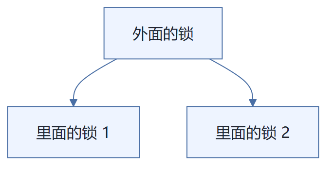

> 拿到了外面的锁之后，就可以拿到里面的锁，**自动获得**。
Synchronized
```java
package com.kuang.lock;
import javax.sound.midi.Soundbank;
// Synchronized
public class Demo01 {
    public static void main(String[] args) {
        Phone phone = new Phone();
        new Thread(()->{
            phone.sms();
        },"A").start();
        new Thread(()->{
            phone.sms();
        },"B").start();
    }
}
class Phone{
    public synchronized void sms(){
        System.out.println(Thread.currentThread().getName() + "sms");
        call(); // 这里也有锁
    }
    public synchronized void call(){
        System.out.println(Thread.currentThread().getName() + "call");
    }
}
```
Lock 版
```java
package com.kuang.lock;
import java.util.concurrent.locks.Lock;
import java.util.concurrent.locks.ReentrantLock;
public class Demo02 {
    public static void main(String[] args) {
        Phone2 phone = new Phone2();
        new Thread(()->{
            phone.sms();
        },"A").start();
        new Thread(()->{
            phone.sms();
        },"B").start();
    }
}
class Phone2{
    Lock lock = new ReentrantLock();
    public void sms(){
        lock.lock(); // 细节问题：lock.lock(); lock.unlock(); // lock 锁必须配对，否 则就会死在里面
        lock.lock();
        try {
            System.out.println(Thread.currentThread().getName() + "sms");
            call(); // 这里也有锁
        } catch (Exception e) {
            e.printStackTrace();
        } finally {
            lock.unlock();
            lock.unlock();
        }
    }
    public void call(){
        lock.lock();
        try {
            System.out.println(Thread.currentThread().getName() + "call");
        } catch (Exception e) {
            e.printStackTrace();
        } finally {
            lock.unlock();
        }
    }
}
```
### 3、自旋锁
spinlock
```java
public native int getLoadAverage(double[] var1, int var2);

public final int getAndAddInt(Object var1, long var2, int var4) {
    int var5;
    do {
        var5 = this.getIntVolatile(var1, var2);
    } while(!this.compareAndSwapInt(var1, var2, var5, var5 + var4));

    return var5;
}

public final long getAndAddLong(Object var1, long var2, long var4) {
```

`getAndAddInt` 的整个方法体：先 `getIntVolatile` 取最新值，再用 `compareAndSwapInt` 做 CAS，失败则自旋重试，成功返回旧值 `var5`。上下相邻的 `getLoadAverage`、`getAndAddLong` 是 `Unsafe` 类中同族的底层方法。
我们来自定义一个锁测试
```java
package com.kuang.lock;
import java.util.concurrent.atomic.AtomicReference;
/**
 * 自旋锁
 */
public class SpinlockDemo {
    // int   0
    // Thread  null
    AtomicReference<Thread> atomicReference = new AtomicReference<>();
    // 加锁
    public void myLock(){
        Thread thread = Thread.currentThread();
        System.out.println(Thread.currentThread().getName() + "==> mylock");
        // 自旋锁
        while (!atomicReference.compareAndSet(null,thread)){
        }
    }
    // 解锁
    // 加锁
    public void myUnLock(){
        Thread thread = Thread.currentThread();
        System.out.println(Thread.currentThread().getName() + "==> myUnlock");
        atomicReference.compareAndSet(thread,null);
    }
}
```
测试
```java
package com.kuang.lock;
import java.util.concurrent.TimeUnit;
import java.util.concurrent.locks.ReentrantLock;
public class TestSpinLock {
    public static void main(String[] args) throws InterruptedException {
//        ReentrantLock reentrantLock = new ReentrantLock();
//        reentrantLock.lock();
//        reentrantLock.unlock();
        // 底层使用的自旋锁CAS
        SpinlockDemo lock = new SpinlockDemo();
        new Thread(()-> {
            lock.myLock();
            try {
                TimeUnit.SECONDS.sleep(5);
            } catch (Exception e) {
                e.printStackTrace();
            } finally {
                lock.myUnLock();
            }
        },"T1").start();
        TimeUnit.SECONDS.sleep(1);
        new Thread(()-> {
            lock.myLock();
            try {
                TimeUnit.SECONDS.sleep(1);
            } catch (Exception e) {
                e.printStackTrace();
            } finally {
                lock.myUnLock();
            }
        },"T2").start();
    }
}
D:\Environment\Java8\jdk8\bin\java.exe ...
T1==> myLock
T2==> myLock
T1==> myUnLock
T2==> myUnLock

Process finished with exit code 0
```
### 4、死锁
死锁是什么
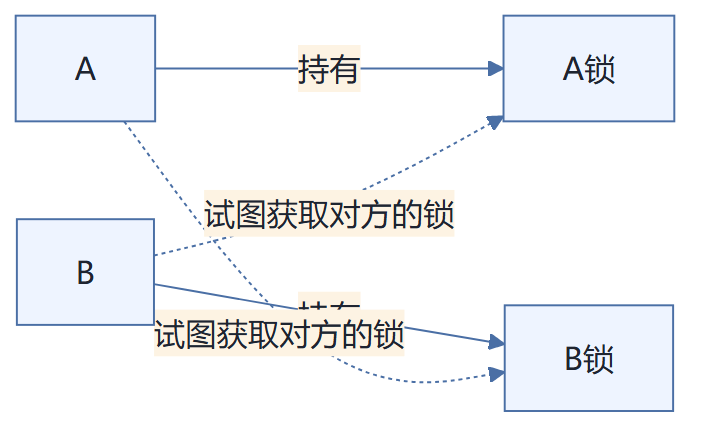

死锁示意：线程 **A** 已经**持有 A锁**，同时又**试图获取对方的锁**（B锁）；线程 **B** 已经**持有 B锁**，同时又**试图获取对方的锁**（A锁）。两者各持一把锁并互相等待对方释放，形成循环等待，谁也不肯放手 —— 这就是死锁。
死锁测试，怎么排除死锁：
```java
package com.kuang.lock;
import com.sun.org.apache.xpath.internal.SourceTree;
import java.util.concurrent.TimeUnit;
public class DeadLockDemo {
    public static void main(String[] args) {
        String lockA = "lockA";
        String lockB = "lockB";
        new Thread(new MyThread(lockA, lockB), "T1").start();
        new Thread(new MyThread(lockB, lockA), "T2").start();
    }
}
class MyThread implements Runnable{
    private String lockA;
    private String lockB;
    public MyThread(String lockA, String lockB) {
        this.lockA = lockA;
        this.lockB = lockB;
    }
    @Override
    public void run() {
        synchronized (lockA){
            System.out.println(Thread.currentThread().getName() +"lock:"+lockA+"=>get"+lockB);
            try {
                TimeUnit.SECONDS.sleep(2);
            } catch (InterruptedException e) {
                e.printStackTrace();
            }
            synchronized (lockB){
                System.out.println(Thread.currentThread().getName() +"lock:"+lockB+"=>get"+lockA);
            }
        }
    }
}
```
解决问题
1、使用
定位进程号
```text
jps -l
Microsoft Windows [版本 10.0.14393]
(c) 2016 Microsoft Corporation。保留所有权利。

C:\Users\Administrator\Desktop\并发编程\juc>jps -l
10048
1140 org.jetbrains.jps.cmdline.Launcher
11444 com.kuang.lock.DeadLockDemo
9400 org.jetbrains.idea.maven.server.RemoteMavenServer
7884 sun.tools.jps.Jps
```

> `jps -l`：定位进程号。其中 `11444 com.kuang.lock.DeadLockDemo` 就是发生死锁的进程号，用于后续 `jstack 11444` 排查死锁。
2、使用
找到死锁问题
```text
jstack 进程号
Found one Java-level deadlock:
=============================
"T2":
  waiting to lock monitor 0x0000000018590f28 (object 0x00000000d5b86a90, a java.lang.String),
  which is held by "T1"
"T1":
  waiting to lock monitor 0x00000000185932e8 (object 0x00000000d5b86ac8, a java.lang.String),
  which is held by "T2"

Java stack information for the threads listed above:
===================================================
"T2":
	at com.kuang.lock.MyThread.run(DeadLockDemo.java:42)
	- waiting to lock <0x00000000d5b86a90> (a java.lang.String)
	- locked <0x00000000d5b86ac8> (a java.lang.String)
	at java.lang.Thread.run(Thread.java:748)
"T1":
	at com.kuang.lock.MyThread.run(DeadLockDemo.java:42)
	- waiting to lock <0x00000000d5b86ac8> (a java.lang.String)
	- locked <0x00000000d5b86a90> (a java.lang.String)
	at java.lang.Thread.run(Thread.java:748)

Found 1 deadlock.
```

定位要点：
- `Found one Java-level deadlock:` 与结尾的 `Found 1 deadlock.` —— 明确报告存在死锁。
- 线程 `"T1"`、`"T2"` 各自的 `waiting to lock` / `locked` 行 —— `T1` 持有 `0x...6a90` 等待 `0x...6ac8`，`T2` 持有 `0x...6ac8` 等待 `0x...6a90`，形成**循环等待**。
- 栈帧 `com.kuang.lock.MyThread.run(DeadLockDemo.java:42)` —— 直接定位到死锁代码位置（`DeadLockDemo.java` 第 42 行）。
面试，工作中！ 排查问题：
1、日志  9
2、堆栈  1
